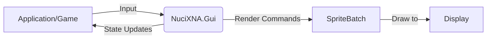
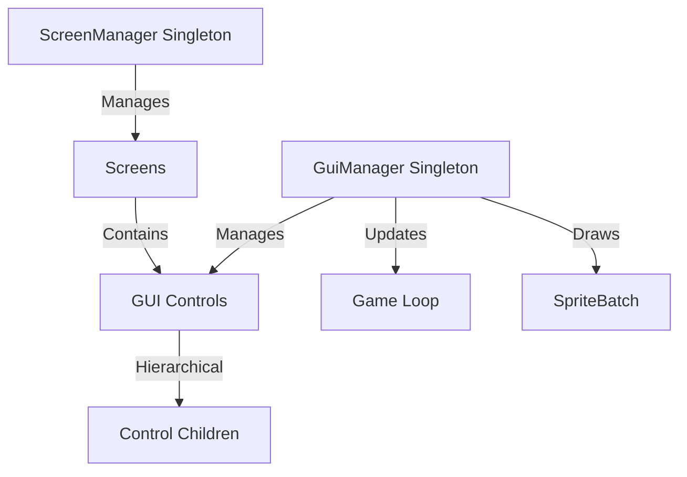
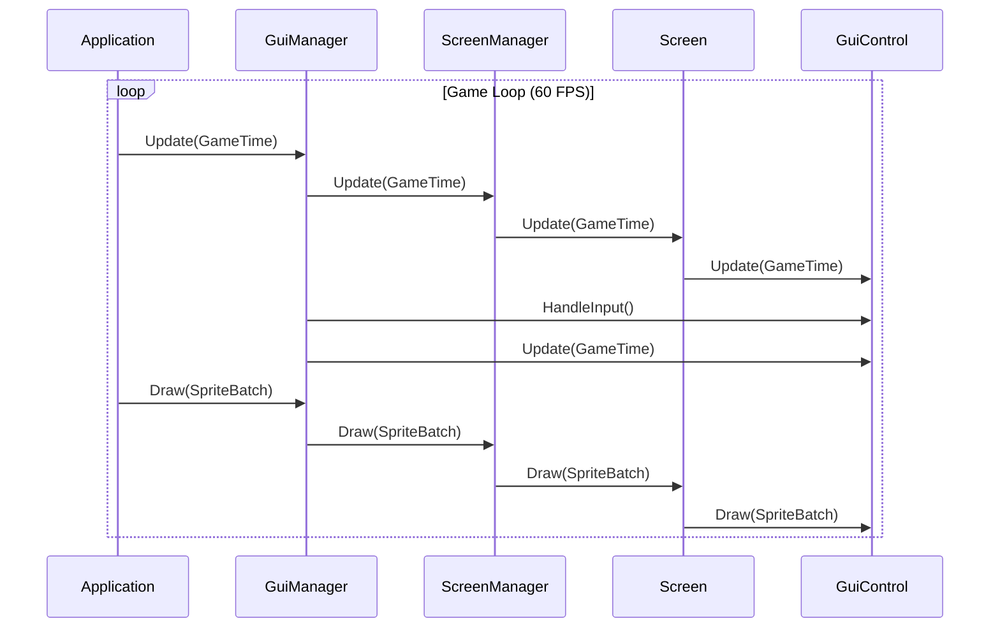
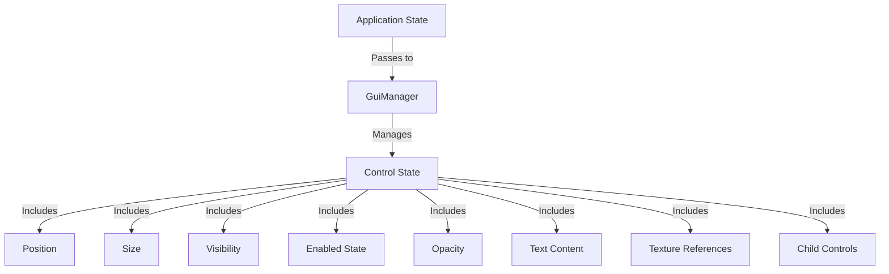
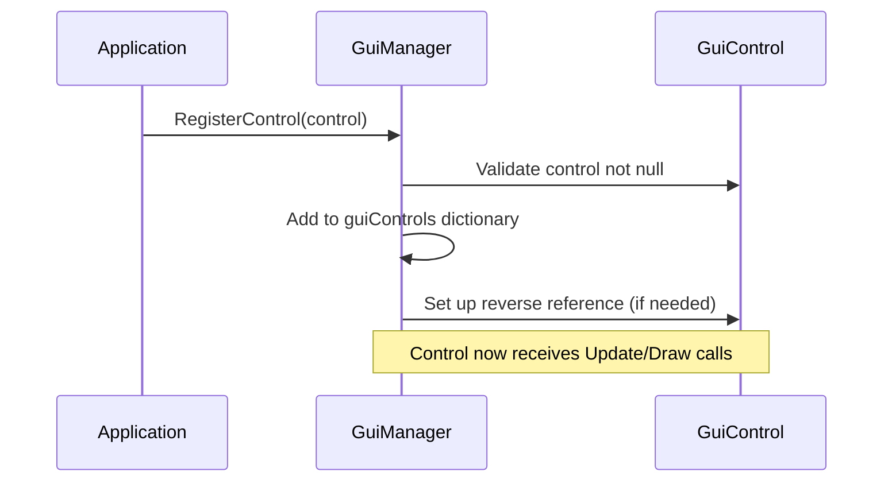
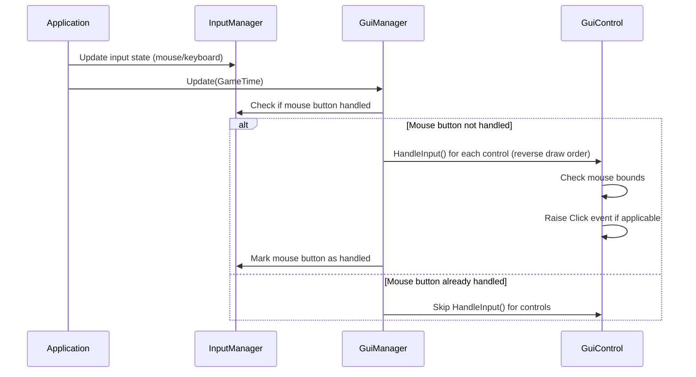
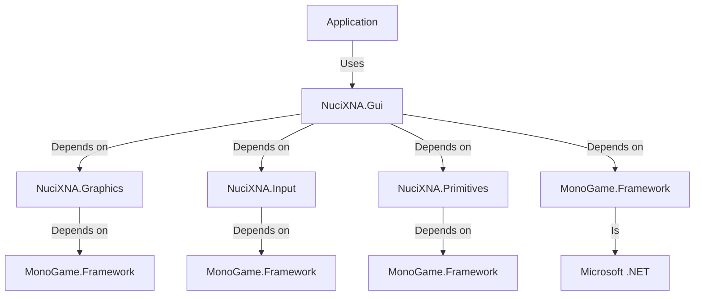

# NuciXNA.Gui Architecture

This document describes the current architecture of the NuciXNA.Gui library, a .NET GUI library for MonoGame/XNA applications.

## 📑 Table of Contents

- [Purpose](#purpose)
- [System Context](#system-context)
- [Architectural Style](#architectural-style)
- [Runtime Flow](#runtime-flow)
- [Components](#components)
- [Architectural Areas](#architectural-areas)
- [Data Architecture](#data-architecture)
- [Interfaces and Integrations](#interfaces-and-integrations)
- [Key Flows](#key-flows)
- [Cross-Cutting Concerns](#cross-cutting-concerns)
- [Dependency Direction and Rules](#dependency-direction-and-rules)
- [External Dependencies](#external-dependencies)
- [Deployment and Operations](#deployment-and-operations)
- [Compatibility Contracts](#compatibility-contracts)
- [Testing and Verification](#testing-and-verification)
- [Design Constraints](#design-constraints)
- [Extension Points](#extension-points)
- [Evolution and Migration](#evolution-and-migration)
- [Architecture Decisions](#architecture-decisions)
- [Source Map](#source-map)
- [Related Documentation](#related-documentation)

## 🎯 Purpose

NuciXNA.Gui provides immediate-mode GUI controls and screen management for MonoGame/XNA games and applications. It enables developers to create interactive user interfaces (buttons, menus, text, images, tooltips) that integrate seamlessly with the game loop. The library is designed for real-time applications where UI updates must synchronize with rendering at 60 FPS.

## 🌐 System Context

NuciXNA.Gui operates as a library within a MonoGame/XNA application. It receives input from the application's input system, renders to the application's sprite batch, and follows the application's game loop timing. The library has no persistent storage, network connectivity, or external service dependencies.



The principal external boundaries are:
- **MonoGame Framework:** Receives GameTime, provides SpriteBatch for rendering
- **NuciXNA.Graphics:** Provides drawing primitives and texture layout functionality
- **NuciXNA.Input:** Provides mouse/keyboard input state
- **NuciXNA.Primitives:** Provides mathematical types (Point2D, Size2D, Rectangle2D, Colour)

## 🏗️ Architectural Style

NuciXNA.Gui follows a **Component-Based Architectural Style** with **Singleton Managers** and **Immediate-Mode GUI** principles. The library implements a retained-mode GUI where controls maintain state between frames, but follows immediate-mode rendering principles where the entire UI is redrawn each frame.



The principal architecture boundaries are:
- **GuiManager:** Owns control registration, update/draw lifecycle, input handling
- **Individual Controls:** Own visual state, layout, behavior, and child controls
- **ScreenManager:** Owns screen transitions and active screen lifecycle
- **Screens:** Own screen-specific control collections and logic

## 🔄 Runtime Flow



The principal runtime sequence is:
1. Application calls GuiManager.Update() with current GameTime
2. GuiManager updates ScreenManager
3. ScreenManager updates current Screen
4. Screen updates its GuiControls
5. GuiManager processes input for controls
6. GuiManager updates controls (position, state, animations)
7. Application calls GuiManager.Draw() with SpriteBatch
8. GuiManager draws ScreenManager
9. ScreenManager draws current Screen
10. Screen draws its GuiControls

## 🧩 Components

| Component | Responsibility | Principal Dependencies | Lifetime or Ownership |
|-----------|----------------|------------------------|-----------------------|
| `GuiManager` | Singleton manager for GUI control lifecycle, input handling, and rendering | NuciXNA.Input, NuciXNA.Gui.Controls | Application lifetime (singleton) |
| `GuiControl` | Abstract base class for all GUI controls - provides layout, state, event handling | NuciXNA.Primitives, NuciXNA.Input | Control lifetime (managed by GuiManager or parent controls) |
| `ScreenManager` | Singleton manager for screen transitions and active screen lifecycle | NuciXNA.Graphics.Drawing, NuciXNA.Graphics.SpriteEffects | Application lifetime (singleton) |
| `IScreen` / `Screen` | Interface/base class for game screens that can contain GUI controls | NuciXNA.Gui.Controls | Screen lifetime (managed by ScreenManager) |
| Concrete Controls (GuiImage, GuiText, etc.) | Specific GUI control implementations with visual rendering and behavior | NuciXNA.Gui.Controls, NuciXNA.Graphics.Drawing | Control lifetime |

## 🗂️ Architectural Areas

### Controls

Paths:
- `NuciXNA.Gui/Controls/`

Responsibilities:
- Provide reusable GUI control implementations (buttons, menus, text, images, etc.)
- Implement visual rendering, input handling, and state management
- Support hierarchical composition (controls can contain child controls)

Boundary rules:
- Depend only on NuciXNA.Gui.Controls, NuciXNA.Primitives, NuciXNA.Input, and NuciXNA.Graphics.Drawing
- Do not depend on ScreenManager or Screens
- Do not have direct access to SpriteBatch or GameTime (receive via method parameters)

### Screens

Paths:
- `NuciXNA.Gui/Screens/`

Responsibilities:
- Manage screen transitions and screen-specific GUI layouts
- Provide base screen functionality for game states (menus, gameplay, settings, etc.)
- Handle screen-level input and update logic

Boundary rules:
- Depend on NuciXNA.Gui.Controls for GUI elements
- Depend on NuciXNA.Graphics and NuciXNA.Graphics.Drawing for rendering
- Do not depend on GuiManager for core functionality (use via singleton access)

### Managers

Paths:
- `NuciXNA.Gui/GuiManager.cs`
- `NuciXNA.Gui/Screens/ScreenManager.cs`

Responsibilities:
- Provide singleton access points for core library functionality
- Manage object lifecycles and global state
- Coordinate between application and library components

Boundary rules:
- Depend on their respective component areas (GuiManager depends on Controls, ScreenManager depends on Screens and Graphics)
- Follow singleton pattern with thread-safe initialization
- Do not depend on each other to avoid circular dependencies

## 💾 Data Architecture

NuciXNA.Gui manages UI state in memory during application execution. All data is transient and exists only for the duration of the application session or until explicitly cleared.



| Data or Store | Owner | Representation and Storage | Lifecycle or Consistency |
|---------------|-------|----------------------------|--------------------------|
| `Control Position` | Individual GuiControl | Point2D structure | Mutable, updated via Layout or animation systems |
| `Control Size` | Individual GuiControl | Size2D structure | Mutable, updated via Layout or explicit setting |
| `Control Visibility` | Individual GuiControl | Boolean flag | Mutable, controlled by application logic |
| `Control Enabled State` | Individual GuiControl | Boolean flag | Mutable, controlled by application logic |
| `Control Opacity` | Individual GuiControl | Float (0.0-1.0) | Mutable, supports fade animations |
| `Control Text` | GuiText/GuiMenuText controls | String | Mutable, updated via application logic |
| `Control Texture` | GuiImage controls | Texture2D reference | Shared, managed by consuming application |
| `Control Hierarchy` | Parent GuiControl | List<GuiControl> | Mutable, supports dynamic UI construction |
| `Registered Controls` | GuiManager | Dictionary<string, GuiControl> | Mutable, cleared on UnloadContent() |
| `Current Screen` | ScreenManager | IScreen reference | Mutable, changes during screen transitions |
| `Transition Sprite` | ScreenManager | TextureSprite with opacity effect | Mutable, used only during screen transitions |

## 🔌 Interfaces and Integrations

| Interface or Integration | Direction | Contract | Owner | Failure Semantics |
|--------------------------|-----------|----------|-------|-------------------|
| `IGuiControl` | Bidirectional | C# interface defining control contract | NuciXNA.Gui.Controls | Compile-time errors if not implemented correctly |
| `IScreen` | Bidirectional | C# interface defining screen contract | NuciXNA.Gui.Screens | Compile-time errors if not implemented correctly |
| `Microsoft.Xna.Framework.GameTime` | Inbound | Game timing structure | MonoGame Framework | Application must provide valid GameTime |
| `Microsoft.Xna.Framework.Graphics.SpriteBatch` | Inbound | Drawing interface | MonoGame Framework | Application must provide valid SpriteBatch |
| `NuciXNA.Input.InputManager` | Inbound | Input state singleton | NuciXNA.Input | Returns default state if not initialized |
| `NuciXNA.Graphics.Drawing.TextureSprite` | Outbound | Drawing utility | NuciXNA.Graphics.Drawing | Falls back to solid color if texture missing |
| `NuciXNA.Graphics.SpriteEffects.FadeEffect` | Outbound | Animation utility | NuciXNA.Graphics.SpriteEffects | Uses default fade parameters if not configured |

## 🔀 Key Flows

### Control Registration Flow



### Screen Transition Flow

```mermaid
sequenceDiagram
    participant App as Application
    participant SM as ScreenManager
    parameter Transition Sprite
    participant TS as TransitionSprite
    participant CS as Current Screen
    participant NS as New Screen

    App->>SM: ChangeScreens<NewScreenType>()
    SM->>NS: Create new screen instance
    SM->>CS: Dispose current screen (if exists)
    SM->>TS: Reset and activate transition sprite
    SM->>SM: Set Transitioning = true
    loop During Transition (approx 1 second)
        App->>SM: Update(GameTime)
        SM->>TS: Update opacity effect
        SM->>TS: Draw transition sprite
        App->>SM: Draw(SpriteBatch)
        SM->>CS: Draw current screen (behind transition)
    end
    SM->>NS: LoadContent() on new screen
    SM->>SM: Set currentScreen = newScreen
    SM->>SM: Set Transitioning = false
```

### Input Handling Flow



## 🧵 Cross-Cutting Concerns

### Security and Privacy

NuciXNA.Gui operates within the trust boundary of the consuming application. It:
- Does not perform input validation or sanitization (assumes trusted input from application)
- Does not encrypt or protect data in memory (relies on application process security)
- Does not communicate externally (no network, file, or registry access)
- Has no secrets or sensitive data to protect
- Relies on the application to handle any sensitive data passed to controls (e.g., password fields in GuiText)

### Error Handling

The library follows these error handling principles:
- **Null Argument Checking:** Public methods validate arguments and throw ArgumentNullException when appropriate
- **State Validation:** Methods check object state (e.g., IsContentLoaded) before performing operations
- **Exception Transparency:** Exceptions from dependencies (MonoGame, NuciXNA.* packages) are not caught unless they can be meaningfully handled
- **Resource Safety:** Implements IDisposable pattern for controls that hold native resources (textures, etc.)
- **Fail Fast:** Assumes consuming application will handle exceptions appropriately for UI failures

### Observability

NuciXNA.Gui provides limited built-in observability:
- **Events:** Controls expose events (Click, LocationChanged, SizeChanged, etc.) for application monitoring
- **State Properties:** All control state (position, size, visibility, etc.) is accessible via properties
- **No Built-in Logging:** Does not include tracing, metrics, or health check endpoints
- **Debug Visualization:** Can be extended with debug rendering overlays (not included in core library)

### Configuration

The library has no external configuration system. All configuration is done programmatically:
- **Default Values:** GuiManager provides default property values for new controls
- **Runtime Properties:** All control properties can be modified at runtime
- **No Configuration Files:** Does not read from app.config, json, xml, or other external sources
- **Theme Support:** Applications must implement their own theming by setting control properties

### Concurrency and Resource Use

- **Thread Safety:** Singleton managers use locks for thread-safe initialization
- **Game Thread Assumption:** All Update/Draw methods are called from the main game thread
- **No Background Processing:** Does not use timers, background threads, or async operations
- **Resource Disposal:** Controls implementing IDisposable properly release native resources
- **Memory Management:** Relies on .NET garbage collection for managed objects
- **Sprite Batch Efficiency:** Designed to work efficiently with SpriteBatch.Draw() calls

## 🧭 Dependency Direction and Rules



The principal dependency rules are:
- **NuciXNA.Gui depends only on:** NuciXNA.Graphics, NuciXNA.Input, NuciXNA.Primitives, and MonoGame.Framework
- **No circular dependencies:** GuiManager does not depend on ScreenManager, and vice versa
- **Layered architecture:** Controls depend on Primitives and Input; Managers depend on Controls and Graphics
- **Stable abstractions:** Interfaces (IGuiControl, IScreen) depend only on primitive types and NuciXNA.* contracts
- **Dependency direction:** Dependencies flow from high-level policy (GuiManager) to low-level details (primitives, input)

## 📦 External Dependencies

| Dependency | Responsibility | Integration Boundary | Architectural Consequence |
|------------|----------------|----------------------|---------------------------|
| `MonoGame.Framework.DesktopGL` | Provides core game framework (GameTime, SpriteBatch, Texture2D, etc.) | Direct usage via Microsoft.Xna.Framework.* namespaces | Ties library to MonoGame 3.8+; requires MonoGame DLLs in application |
| `NuciXNA.Graphics` | Provides drawing primitives, texture layout, and sprite effects | Via NuciXNA.Graphics.Drawing and NuciXNA.Graphics.SpriteEffects namespaces | Enables advanced rendering features; tight coupling to NuciXNA ecosystem |
| `NuciXNA.Input` | Provides input state management (mouse, keyboard, gamepad) | Via NuciXNA.Input.InputManager singleton | Centralizes input handling; requires InputManager to be updated by application |
| `NuciXNA.Primitives` | Provides mathematical types (Point2D, Size2D, Rectangle2D, Colour) | Via NuciXNA.Primitives namespace | Provides type safety and consistency; minimal coupling impact |

## 🚀 Deployment and Operations

| Concern | Current Design | Architectural Consequence |
|---------|----------------|---------------------------|
| **Process topology** | Single-threaded library operating within application's main thread | No inter-process communication; all calls synchronous |
| **Persistent state** | None - all state is transient memory state | Application must persist UI state if needed (e.g., via serialization) |
| **Filesystem/network requirements** | None - library performs no I/O operations | Zero deployment footprint beyond DLL references |
| **Scaling assumptions** | Designed for fixed-resolution or scalable UI via layout systems | Applications must handle resolution changes and DPI scaling |
| **Startup responsibilities** | Application must initialize dependencies and call LoadContent() | Clear initialization sequence required |
| **Shutdown responsibilities** | Application must call UnloadContent() to release resources | Prevents resource leaks in long-running applications |
| **Operator-visible outputs** | Visual GUI elements rendered to screen; no console/log output | Debugging requires visual inspection or application-provided logging |

## 🛡️ Compatibility Contracts

| Contract | Owner | Invariant | Verification | Change Policy |
|----------|-------|-----------|--------------|---------------|
| `IGuiControl Interface` | NuciXNA.Gui.Controls | All GUI controls must implement Id, Location, Size, Visible, Enabled, Opacity properties and Update/Draw/HandleInput/LoadContent/UnloadContent methods | Compile-time verification; unit tests for concrete implementations | Major version change required for breaking changes |
| `IScreen Interface` | NuciXNA.Gui.Screens | All screens must implement LoadContent, UnloadContent, Update, Draw methods | Compile-time verification; integration tests | Major version change required for breaking changes |
| `Control Event Signatures` | NuciXNA.Gui.Controls | Events like Click, LocationChanged, SizeChanged use standard .NET EventHandler patterns | Compile-time verification; usage testing | Minor version change for additions; major for breaking changes |
| `Default Property Values` | GuiManager | DefaultBackgroundColour, DefaultForegroundColour, etc. have sensible defaults | Unit tests; visual regression testing | Minor version change with documentation |
| `Singleton Access Pattern` | GuiManager, ScreenManager | Instance property returns thread-safe singleton | Unit tests; stress testing | Major version change required |

## ✅ Testing and Verification

The library architecture is verified through:
- **Unit Tests:** NuciXNA.Gui.UnitTests project tests individual control behavior and manager functionality
- **Integration Tests:** Manual testing of control composition and screen transitions
- **Runtime Verification:** Visual verification of rendering and input handling
- **Contract Testing:** Verification that interfaces are properly implemented by concrete classes

Execute the principal automated verification with:

```bash
dotnet test NuciXNA.GUI.slnx
```

## ⚠️ Design Constraints

- **Real-time Performance:** All operations must complete within 16ms (60 FPS) frame budget
- **Immediate Mode Rendering:** Entire UI redrawn each frame; no retained rendering buffers
- **MonoGame Coupling:** Tightly coupled to MonoGame 3.8+ API surface
- **No External Dependencies:** Cannot depend on network, databases, or file systems
- **Backward Compatibility:** Must maintain compatibility with existing GuiControl implementations
- **Threading Model:** Assumes single-threaded game loop; no built-in multi-threading support

## 🔧 Extension Points

### Custom Control Extension

1. **Implement or revise the owning contract:** Inherit from GuiControl abstract class or implement IGuiControl interface
2. **Register or integrate the implementation:** Instantiate and register with GuiManager or add as child to existing control
3. **Add the verification required to preserve neighbouring contracts:** Ensure Update, Draw, HandleInput, LoadContent, UnloadContent methods follow expected patterns

[[State any naming, lifetime, protocol, ordering, or compatibility convention that the extension must preserve.]]
- Controls must follow the Update/Draw game loop pattern
- Controls must properly dispose of native resources
- Controls must raise events for state changes
- Controls must respect parent control transformations (location, size, opacity)

### Custom Screen Extension

1. **Implement or revise the owning contract:** Inherit from Screen base class or implement IScreen interface
2. **Register or integrate the implementation:** Set as StartingScreenType or change to via ScreenManager.ChangeScreens()
3. **Add the verification required to preserve neighbouring contracts:** Ensure LoadContent, UnloadContent, Update, Draw methods follow expected patterns

[[State any naming, lifetime, protocol, ordering, or compatibility convention that the extension must preserve.]]
- Screens must properly load and unload content
- Screens must manage their own control collections
- Screens must follow the Update/Draw game loop pattern
- Screens must coordinate with ScreenManager for transitions

## 🌱 Evolution and Migration

### Current State

NuciXNA.Gui provides immediate-mode GUI controls with singleton managers, component-based controls, and screen management. The library is tightly integrated with the MonoGame game loop and provides no persistent state or external integrations.

### Target State

The library could evolve toward:
- More flexible rendering backends (not tied to MonoGame SpriteBatch)
- Optional persistent state management for UI configurations
- Enhanced theming and styling systems
- Accessibility improvements (keyboard navigation, screen reader support)
- More sophisticated layout systems (anchoring, docking, grid-based)

### Transition

1. **Abstract rendering interface:** Introduce IRenderer abstraction to decouple from MonoGame SpriteBatch
2. **Add persistence options:** Optional JSON/XML serialization for control state
3. **Enhance theming system:** Introduce theme resources and style inheritance
4. **Improve accessibility:** Add keyboard focus management and ARIA-like properties
5. **Modularize layout system:** Extract layout logic into reusable components

Compatibility requirements:
- **IGuiControl contract must remain stable** - existing controls must continue to work
- **Singleton manager pattern must be preserved** - GuiManager and ScreenManager access must remain consistent
- **Game loop integration must be maintained** - Update/Draw methods must continue to be called per frame
- **Event-based interaction model must be preserved** - Controls must continue to raise events for state changes

## 📝 Architecture Decisions

| Decision | Rationale | Consequence | Record |
|----------|-----------|-------------|--------|
| **Singleton Managers** | Simplifies access from anywhere in application; avoids passing manager references everywhere | Global state that complicates testing; tight coupling to manager classes | Documented here |
| **Immediate Mode Rendering** | Simplifies implementation; matches MonoGame/XNA rendering paradigm | Higher GPU usage; no batching optimization opportunities | Documented here |
| **Component-Based Controls** | Enables complex UIs through composition; follows established GUI patterns | Requires careful management of parent-child relationships; potential for deep hierarchies | Documented here |
| **Event-Based Interaction** | Familiar .NET pattern; decouples controls from application logic | Potential for memory leaks if events not properly unsubscribed | Documented here |
| **Dependency on NuciXNA.* Packages** | Leverages existing utility libraries; reduces code duplication | Creates ecosystem lock-in; requires consumers to use entire NuciXNA stack | Documented here |
| **No Built-in Theming** | Keeps core library simple; allows applications to implement their own styling | Applications must duplicate styling logic; inconsistent look and feel across apps | Documented here |

## 🗺️ Source Map

| Area | Path |
|------|------|
| Controls | `NuciXNA.Gui/Controls/` |
| Screens | `NuciXNA.Gui/Screens/` |
| Managers | `NuciXNA.Gui/GuiManager.cs`, `NuciXNA.Gui/Screens/ScreenManager.cs` |
| Project File | `NuciXNA.Gui/NuciXNA.Gui.csproj` |
| Unit Tests | `NuciXNA.Gui.UnitTests/` |

## 📚 Related Documentation

- [README.md](README.md) - General project overview and usage instructions
- [CONTRIBUTING.md](CONTRIBUTING.md) - Guidelines for contributing to the project
- [SECURITY.md](SECURITY.md) - Security vulnerability reporting policy
- [PRIVACY.md](PRIVACY.md) - Privacy and personal data handling information
- [LICENSE](LICENSE) - MIT license terms