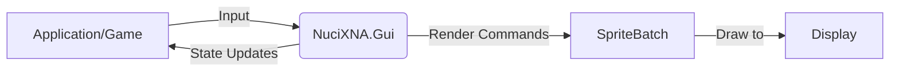
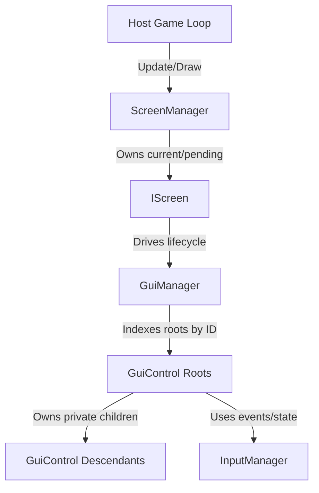
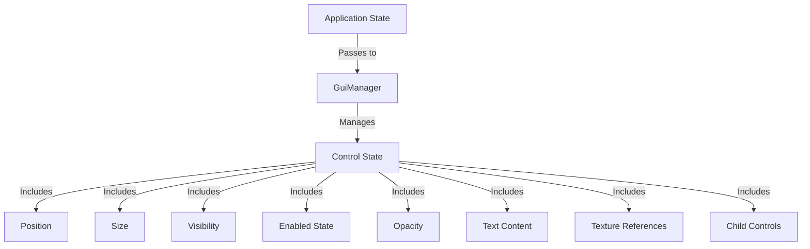
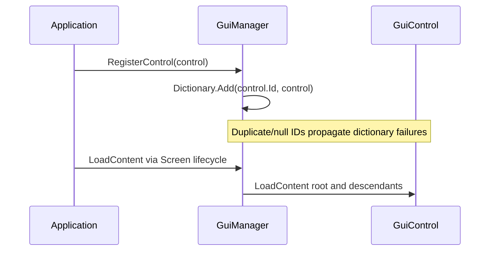
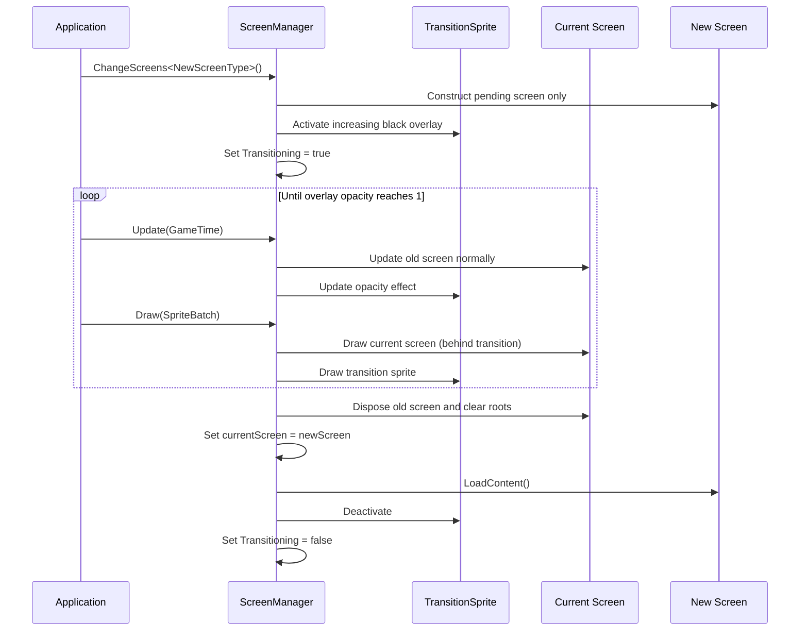
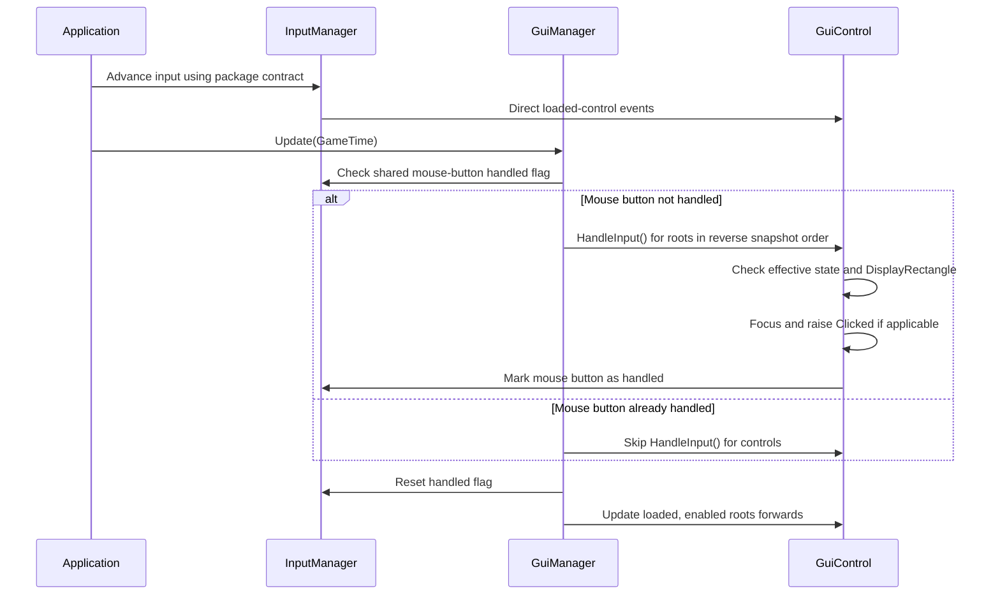
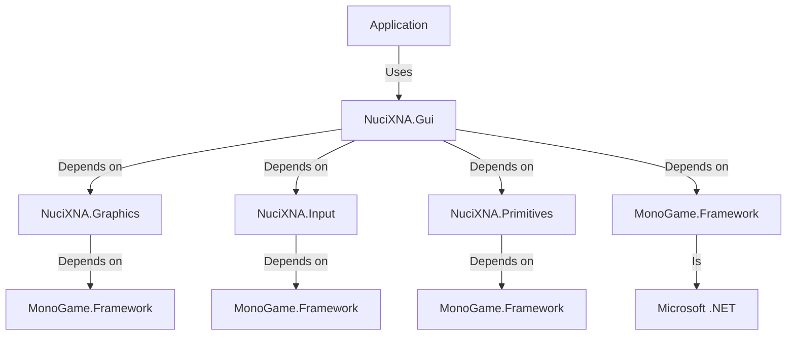

# NuciXNA.Gui Architecture

This document describes the current architecture of the NuciXNA.Gui library, a .NET GUI library for MonoGame/XNA applications.

## 📑 Table of Contents

- [Purpose](#purpose)
- [System Context](#system-context)
- [Architectural Style](#architectural-style)
- [Runtime Flow](#runtime-flow)
- [Components](#components)
- [Architectural Areas](#architectural-areas)
    - [Controls](#controls)
    - [Screens](#screens)
    - [Managers](#managers)
- [Data Architecture](#data-architecture)
- [Interfaces and Integrations](#interfaces-and-integrations)
- [Key Flows](#key-flows)
    - [Control Registration Flow](#control-registration-flow)
    - [Screen Transition Flow](#screen-transition-flow)
    - [Input Handling Flow](#input-handling-flow)
- [Cross-Cutting Concerns](#cross-cutting-concerns)
    - [Security and Privacy](#security-and-privacy)
    - [Error Handling](#error-handling)
    - [Observability](#observability)
    - [Configuration](#configuration)
    - [Concurrency and Resource Use](#concurrency-and-resource-use)
- [Dependency Direction and Rules](#dependency-direction-and-rules)
- [External Dependencies](#external-dependencies)
- [Deployment and Operations](#deployment-and-operations)
- [Compatibility Contracts](#compatibility-contracts)
- [Testing and Verification](#testing-and-verification)
- [Design Constraints](#design-constraints)
- [Extension Points](#extension-points)
    - [Custom Control Extension](#custom-control-extension)
    - [Custom Screen Extension](#custom-screen-extension)
- [Architecture Decisions](#architecture-decisions)
- [Source Map](#source-map)
- [Related Documentation](#related-documentation)

## 🎯 Purpose

NuciXNA.Gui provides retained GUI controls, menu interaction, cursor rendering, and screen lifecycle utilities for MonoGame/NuciXNA hosts. This current-state document records ownership, synchronous lifecycle order, integration boundaries, and compatibility-sensitive behaviour for consumers and contributors; host game logic and external package internals remain outside its scope.

## 🌐 System Context

NuciXNA.Gui operates as a library within a MonoGame/XNA application. It receives input from the application's input system, renders to the application's sprite batch, and follows the application's game loop timing. The library has no persistent storage, network connectivity, or external service dependencies.



The principal external boundaries are:
- **MonoGame Framework:** Receives GameTime, provides SpriteBatch for rendering
- **NuciXNA.Graphics:** Provides drawing primitives and texture layout functionality
- **NuciXNA.Input:** Provides mouse/keyboard input state
- **NuciXNA.Primitives:** Provides mathematical types (Point2D, Size2D, Rectangle2D, Colour)

## 🏗️ Architectural Style

NuciXNA.Gui combines retained component trees, template-method lifecycles, synchronous events, and singleton-based coordination. Controls retain state and ancestry between frames; the host chooses when to redraw them through MonoGame. Locked lazy construction protects only `Instance` creation, while mutable runtime state assumes serialised host access.



The principal architecture boundaries are:
- **GuiManager:** Owns the global root-control dictionary, root lifecycle traversal, click/focus arbitration, and defaults.
- **Individual Controls:** Own retained visual/input/lifecycle state and private child-control lists.
- **ScreenManager:** Owns current/pending screen references, transition overlay, and cached back-buffer size.
- **Screens:** Own screen-specific hooks and drive the global GuiManager lifecycle; they expose no public control collection.

## 🔄 Runtime Flow

```mermaid
sequenceDiagram
    participant App as Application
    participant SM as ScreenManager
    participant S as Screen
    participant GM as GuiManager
    participant C as GuiControl

    App->>SM: StartingScreenType; LoadContent()
    SM->>S: Construct and LoadContent()
    S->>S: DoLoadContent registers roots
    S->>GM: LoadContent()
    GM->>C: Load roots and children

    loop Host-selected game loop cadence
        App->>SM: Update(GameTime)
        SM->>S: Update(GameTime)
        S->>S: DoUpdate(GameTime)
        S->>GM: Update(GameTime)
        GM->>C: Reverse HandleInput; forward Update

        App->>SM: Draw(SpriteBatch)
        SM->>S: Draw(SpriteBatch)
        S->>S: Clear; DoDraw(SpriteBatch)
        S->>GM: Draw(SpriteBatch)
        GM->>C: Draw roots and children
    end

    App->>SM: UnloadContent()
    SM->>S: Dispose and unload
    S->>GM: Unload roots and clear registry
```

The principal runtime sequence is:
1. The host configures and loads `ScreenManager`, which constructs/loads the starting screen and fixed transition sprite.
2. `Screen.LoadContent` invokes its hook, then `GuiManager.LoadContent` loads every registered root and descendant.
3. Each host update reaches the current screen, screen hook, manager reverse click polling, and forward control update traversal; an active transition advances afterwards.
4. Each host draw reaches current-screen clear/hook, manager control drawing, and then the transition overlay when active.
5. Shutdown or an opaque transition disposes the current screen; screen unload unloads and clears the complete root registry.

## 🧩 Components

| Component | Responsibility | Principal Dependencies | Lifetime or Ownership |
|-----------|----------------|------------------------|-----------------------|
| `GuiManager` | Root registry, lifecycle traversal, click/focus arbitration, defaults | NuciXNA.Input, controls | Static instance normally used; public constructor permits others |
| `GuiControl` | Retained state, effective values, child ownership, input events, lifecycle hooks | NuciXNA.Primitives, NuciXNA.Input | Root manager or parent control |
| `ScreenManager` | Current/pending screen and transition overlay | NuciXNA.Graphics, `IScreen` | Static instance normally used; host drives lifecycle |
| `IScreen` / `Screen` | Screen lifecycle, clear colour, input forwarding, manager coordination | GuiManager, graphics, input | ScreenManager |
| Concrete controls | Graphics wrapper composition and menu/selection behaviour | Base control, NuciXNA.Graphics | Root manager or parent control |
| `Cursor` | Independent custom pointer sprites and input subscriptions | NuciXNA.Graphics, NuciXNA.Input | Consuming host |

## 🗂️ Architectural Areas

### Controls

Paths:
- `NuciXNA.Gui/Controls/`

Responsibilities:
- Provide reusable GUI control implementations (buttons, menus, text, images, etc.)
- Implement visual rendering, input handling, and state management
- Support hierarchical composition (controls can contain child controls)

Boundary rules:
- Base and visual controls depend on primitives, input, graphics wrappers/effects, and MonoGame method parameters.
- `GuiMenuLink` and `GuiTooltip` depend on `ScreenManager`; the controls area is not isolated from screens.
- Descendants are private parent-owned children; only roots belong in `GuiManager`.

### Screens

Paths:
- `NuciXNA.Gui/Screens/`

Responsibilities:
- Manage screen transitions and screen-specific GUI layouts
- Provide base screen functionality for game states (menus, gameplay, settings, etc.)
- Handle screen-level input and update logic

Boundary rules:
- Depend on NuciXNA.Gui.Controls for GUI elements
- Depend on NuciXNA.Graphics and NuciXNA.Graphics.Drawing for rendering
- `Screen` directly drives `GuiManager` after each derived hook; `MenuScreen` registers and focuses menu roots.

### Managers

Paths:
- `NuciXNA.Gui/GuiManager.cs`
- `NuciXNA.Gui/Screens/ScreenManager.cs`

Responsibilities:
- Provide singleton access points for core library functionality
- Manage object lifecycles and global state
- Coordinate between application and library components

Boundary rules:
- `GuiManager` depends on controls/input; `ScreenManager` depends on screens/graphics.
- Static `Instance` construction is locked, but constructors remain public and mutable operations are not generally thread-safe.
- Managers do not directly call each other; `Screen` bridges screen management to control management.

## 💾 Data Architecture

NuciXNA.Gui manages UI state in memory during application execution. All data is transient and exists only for the duration of the application session or until explicitly cleared.



| Data or Store | Owner | Representation and Storage | Lifecycle or Consistency |
|---------------|-------|----------------------------|--------------------------|
| `Control Position` | Individual GuiControl | Point2D structure | Mutable, updated via Layout or animation systems |
| `Control Size` | Individual GuiControl | Size2D structure | Mutable, updated via Layout or explicit setting |
| `Control Visibility` | Individual GuiControl | Boolean flag | Mutable, controlled by application logic |
| `Control Enabled State` | Individual GuiControl | Boolean flag | Mutable, controlled by application logic |
| `Control Opacity` | Individual GuiControl | Float (0.0-1.0) | Mutable, supports fade animations |
| `Control Text` | GuiText/GuiMenuText controls | String | Mutable, updated via application logic |
| `Control Content` | GuiImage/GuiText controls | Content identifiers and owned graphics wrappers | Loaded/unloaded with control lifecycle |
| `Control Hierarchy` | Parent GuiControl | Private `List<GuiControl>` plus public Parent reference | Protected registration; unload clears children |
| `Registered Controls` | GuiManager | Dictionary<string, GuiControl> | Mutable, cleared on UnloadContent() |
| `Current/Pending Screen` | ScreenManager | Private `IScreen` references | Pending constructed at request; loaded after old disposal |
| `Transition Sprite` | ScreenManager | TextureSprite with opacity effect | Mutable, used only during screen transitions |

## 🔌 Interfaces and Integrations

| Interface or Integration | Direction | Contract | Owner | Failure Semantics |
|--------------------------|-----------|----------|-------|-------------------|
| `IGuiControl` | In-process public API | Control properties, events, and lifecycle; concrete Parent type | NuciXNA.Gui.Controls | Child registration casts to GuiControl; independent implementations fail there |
| `IScreen` | In-process public API | Screen properties, events, lifecycle, and disposal | NuciXNA.Gui.Screens | ScreenManager reflected path casts to Screen despite interface constraint |
| `Microsoft.Xna.Framework.GameTime` | Inbound | Game timing structure | MonoGame Framework | Application must provide valid GameTime |
| `Microsoft.Xna.Framework.Graphics.SpriteBatch` | Inbound | Drawing interface | MonoGame Framework | Application must provide valid SpriteBatch |
| `NuciXNA.Input.InputManager` | Bidirectional package boundary | Direct events plus mouse state/handled-flag queries | NuciXNA.Input/host | Package/event exceptions propagate; host owns input lifecycle |
| `NuciXNA.Graphics.Drawing.TextureSprite` | Outbound | Content-backed image/cursor/overlay wrapper | NuciXNA.Graphics | Graphics/content exceptions propagate |
| `NuciXNA.Graphics.SpriteEffects.FadeEffect` | Outbound | Fixed transition and menu text effects | NuciXNA.Graphics | Effect exceptions propagate; transition parameters are hard-coded |

## 🔀 Key Flows

### Control Registration Flow



### Screen Transition Flow



### Input Handling Flow



## 🧵 Cross-Cutting Concerns

### Security and Privacy

NuciXNA.Gui operates within the trust boundary of the consuming application. It:
- Performs limited lifecycle/range validation and otherwise trusts host types, constructor arguments, content identifiers, input, effects, and event handlers.
- Does not encrypt or protect in-memory UI state; host process security and data policy apply.
- Contains no built-in network, persistence, logging, telemetry, authentication, or secret storage.
- Relies on the host to constrain untrusted resource sizes/graphs and sensitive displayed data.
- Treats package/content sources and reflection targets as supply-chain/trust boundaries.

### Error Handling

The library follows these error handling principles:
- **State Validation:** Control/screen base lifecycles reject invalid loaded state with `InvalidOperationException`.
- **Argument/Reflection Validation:** Managers perform little explicit validation; dictionary/reflection/cast exceptions propagate.
- **Exception Transparency:** Dependency, hook, and event-handler exceptions propagate without logging/retry/translation.
- **Partial Failure:** Load/unload loops and transition swaps have no rollback transaction.
- **Selective Suppression:** Selector `TrySelectItem` catches only its documented lookup exception; active transition requests return silently.

### Observability

NuciXNA.Gui provides limited built-in observability:
- **Events:** Controls/screens expose lifecycle, property, input, `Clicked`, trigger, toggle, and selection events.
- **State Properties:** All control state (position, size, visibility, etc.) is accessible via properties
- **No Built-in Logging:** Does not include tracing, metrics, or health check endpoints
- **Diagnostic Gap:** No trace correlation, event IDs, diagnostic renderer, benchmark, or health signal is built in.

### Configuration

The library has no external configuration system. All configuration is done programmatically:
- **Default Values:** GuiManager supplies colour/font/texture-layout fallbacks; `DefaultMargins` currently has no production consumer.
- **Runtime Properties:** Public manager/control/cursor properties configure behaviour; some state uses methods/private setters.
- **No Configuration Files:** Does not read from app.config, json, xml, or other external sources
- **Theme Support:** Applications must implement their own theming by setting control properties

### Concurrency and Resource Use

- **Thread Safety:** Manager `Instance` creation is locked; collections and lifecycle methods are not generally thread-safe.
- **Caller Thread:** Methods/events execute synchronously on their caller. A MonoGame host normally serialises them on its graphics/game thread, but the library does not enforce affinity.
- **No Background Processing:** Does not use timers, background threads, or async operations
- **Resource Disposal:** Screen/control disposal unloads graphics wrappers and unsubscribes events; manager unload does not explicitly dispose roots.
- **Memory Management:** Relies on .NET garbage collection for managed objects
- **Capacity Evidence:** The repository contains no benchmark or frame-budget guarantee; hosts must profile representative control trees/assets/effects.

## 🧭 Dependency Direction and Rules



The principal dependency rules are:
- **NuciXNA.Gui depends only on:** NuciXNA.Graphics, NuciXNA.Input, NuciXNA.Primitives, and MonoGame.Framework
- **Manager direction:** GuiManager does not call ScreenManager; Screen bridges ScreenManager to GuiManager.
- **Cross-area dependencies:** GuiMenuLink/GuiTooltip/MenuScreen reach ScreenManager, so controls/screens are not strict layers.
- **Public coupling:** IGuiControl and IScreen expose MonoGame, NuciXNA.Input, and NuciXNA.Primitives types.
- **Ownership:** Register only roots with GuiManager; descendants belong to parent private lists.

## 📦 External Dependencies

| Dependency | Responsibility | Integration Boundary | Architectural Consequence |
|------------|----------------|----------------------|---------------------------|
| `MonoGame.Framework.DesktopGL` | Provides core game framework (GameTime, SpriteBatch, Texture2D, etc.) | Direct usage via Microsoft.Xna.Framework.* namespaces | Ties library to MonoGame 3.8+; requires MonoGame DLLs in application |
| `NuciXNA.Graphics` | Provides drawing primitives, texture layout, and sprite effects | Via NuciXNA.Graphics.Drawing and NuciXNA.Graphics.SpriteEffects namespaces | Enables advanced rendering features; tight coupling to NuciXNA ecosystem |
| `NuciXNA.Input` | Provides input state management (mouse, keyboard, gamepad) | Via NuciXNA.Input.InputManager singleton | Centralizes input handling; requires InputManager to be updated by application |
| `NuciXNA.Primitives` | Provides mathematical types (Point2D, Size2D, Rectangle2D, Colour) | Via NuciXNA.Primitives namespace | Provides type safety and consistency; minimal coupling impact |

## 🚀 Deployment and Operations

| Concern | Current Design | Architectural Consequence |
|---------|----------------|---------------------------|
| **Process topology** | In-process synchronous library; no internal worker/scheduler | Host serialises lifecycle on a MonoGame-compatible thread |
| **Persistent state** | None - all state is transient memory state | Application must persist UI state if needed (e.g., via serialization) |
| **Filesystem/network requirements** | No direct I/O/network source; content resolution belongs to NuciXNA.Graphics/host | Deploy assembly/dependencies and required host assets/fonts |
| **Scaling assumptions** | Screen manager tracks back-buffer size; menu/tooltip use it | Host owns DPI/content/layout policy; size is not refreshed mid-transition |
| **Startup responsibilities** | Application must initialize dependencies and call LoadContent() | Clear initialization sequence required |
| **Shutdown responsibilities** | Application must call UnloadContent() to release resources | Prevents resource leaks in long-running applications |
| **Operator-visible outputs** | Visual GUI elements rendered to screen; no console/log output | Debugging requires visual inspection or application-provided logging |

## 🛡️ Compatibility Contracts

| Contract | Owner | Invariant | Verification | Change Policy |
|----------|-------|-----------|--------------|---------------|
| `IGuiControl Interface` | NuciXNA.Gui.Controls | Public properties/events/lifecycle plus concrete GuiControl Parent | Compilation and base-control tests; independent implementations untested | Treat signature/semantics changes as public compatibility changes |
| `IScreen Interface` | NuciXNA.Gui.Screens | Public screen properties/events/lifecycle/disposal | Compilation and Screen tests; independent implementations untested | Align interface and manager concrete-cast policy deliberately |
| `Lifecycle/Event Order` | GuiControl/Screen | Hooks, children/manager calls, flags, and events preserve order | Unit event traces; integration gaps documented | Add characterisation tests before change |
| `Content Identifiers` | Graphics-using types | Conventional fill/cursor/font identifiers remain resolvable | Host/manual integration | Document/migrate asset changes with consumers |
| `Manager Instance Access` | Managers and internal callers | Static Instance is the internally used coordinator | Compilation; no focused singleton stress tests | Public constructor/static-access changes require migration analysis |

## ✅ Testing and Verification

The library architecture is verified through:
- **Unit Tests:** NuciXNA.Gui.UnitTests covers base control/screen lifecycle/properties and menu-control state/behaviour.
- **Coverage Gaps:** No focused manager, transition, MenuScreen, Cursor, GuiText, GuiImage, GuiTooltip, graphics-device, or end-to-end input tests.
- **Manual Verification:** Rendering/content/input/transitions require a representative MonoGame/NuciXNA host until integration automation exists.
- **CI:** Ubuntu restores, builds, and runs tests after installing .NET 10 and Microsoft core fonts; no coverage report is configured.

Execute the principal automated verification with:

```bash
dotnet test NuciXNA.GUI.slnx
```

## ⚠️ Design Constraints

- **No Published Performance Budget:** Traversal scales with roots/descendants and graphics effects; benchmark in the host.
- **Retained State, Per-Frame Draw:** No dirty-region/render cache; host controls cadence/batching.
- **MonoGame/NuciXNA Coupling:** Public contracts directly expose package types and exact declared dependency versions.
- **Global State:** Internal code hardcodes static manager instances even though constructors are public.
- **No Persistence/Networking/Logging:** Hosts own these concerns and any resulting privacy/security boundary.
- **Synchronous Mutable State:** No general concurrency/thread-affinity enforcement.
- **Partial Failure:** Lifecycle loops and transition swap have no rollback transaction.

## 🔧 Extension Points

### Custom Control Extension

1. Inherit from `GuiControl` and implement all four protected lifecycle hooks.
2. Register roots through `GuiManager` during screen `DoLoadContent`; register descendants through protected child methods.
3. Add lifecycle, inheritance, input, draw-order, failure, and disposal tests.

Independent `IGuiControl` implementations cannot be registered as children because child registration casts to `GuiControl`. Preserve hook/event/child ordering and unsubscribe external events on unload.

### Custom Screen Extension

1. Inherit from `Screen` and implement its four protected lifecycle hooks.
2. Supply it as `StartingScreenType` or through `ScreenManager.ChangeScreens`, with matching constructor arguments.
3. Add lifecycle, root-registry, input, transition, and failure tests.

The manager's reflected transition path casts to concrete `Screen`, so independent `IScreen` implementations are not currently viable. Register roots in `DoLoadContent`; the base screen loads them afterwards.

## 📝 Architecture Decisions

| Decision | Rationale | Consequence | Record |
|----------|-----------|-------------|--------|
| Static manager instances | Historical rationale is not recorded; production code consistently uses `Instance` | Global mutable state and difficult substitution despite public constructors | [Design Decisions](docs/design-decisions.md) |
| Retained controls with per-frame drawing | Matches implemented stateful controls and host-driven MonoGame draw calls | No dirty-region/cache; host profiles actual cost | [Design Decisions](docs/design-decisions.md) |
| Template-method lifecycle | Base classes enforce observed hook/event/child-manager order | Derived types must preserve base-hook dependencies | [Design Decisions](docs/design-decisions.md) |
| Synchronous input/events | Directly follows NuciXNA.Input and .NET event implementation | Subscriber work/failures occur inline; unload balance is material | [Design Decisions](docs/design-decisions.md) |
| In-memory state only | No persistence/configuration provider exists in production source | Host owns durable state and all resulting data policy | [State and Persistence](docs/state-and-persistence.md) |
| Fixed black transition overlay | ScreenManager constructs one hard-coded TextureSprite/FadeEffect | No public strategy/duration; pending load occurs after old disposal | [Screen Transitions](docs/flows/screen-transitions.md) |

## 🗺️ Source Map

| Area | Path |
|------|------|
| Controls | [`NuciXNA.Gui/Controls/`](NuciXNA.Gui/Controls/) |
| Screens | [`NuciXNA.Gui/Screens/`](NuciXNA.Gui/Screens/) |
| Managers | [`GuiManager.cs`](NuciXNA.Gui/GuiManager.cs), [`ScreenManager.cs`](NuciXNA.Gui/Screens/ScreenManager.cs) |
| Project File | [`NuciXNA.Gui.csproj`](NuciXNA.Gui/NuciXNA.Gui.csproj) |
| Unit Tests | [`NuciXNA.Gui.UnitTests/`](NuciXNA.Gui.UnitTests/) |

## 📚 Related Documentation

- [README.md](README.md) - General project overview and usage instructions
- [Documentation Index](docs/INDEX.md) - Detailed repository knowledge base and navigation
- [Detailed Architecture](docs/architecture.md) - Implementation-level architecture mechanics
- [API Reference](docs/api-reference/INDEX.md) - Exact public contracts and edge semantics
- [CONTRIBUTING.md](CONTRIBUTING.md) - Guidelines for contributing to the project
- [SECURITY.md](SECURITY.md) - Security vulnerability reporting policy
- [PRIVACY.md](PRIVACY.md) - Privacy and personal data handling information
- [LICENSE](LICENSE) - GNU General Public License v3.0 or later