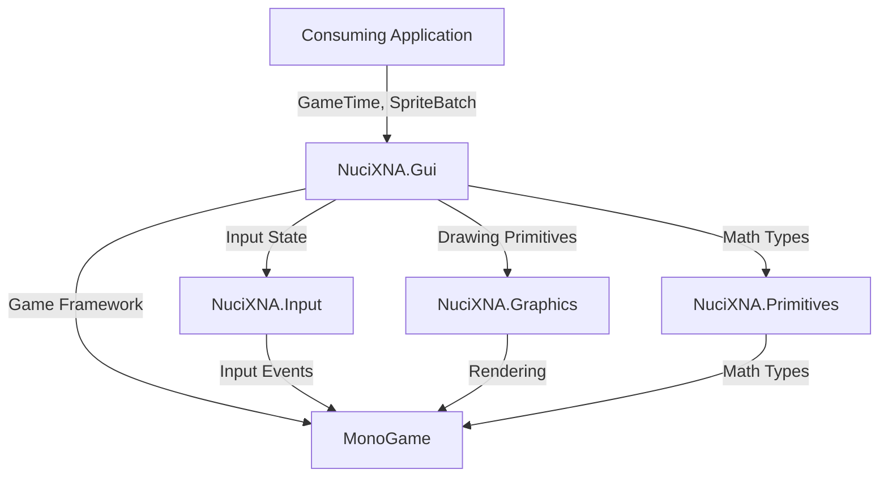
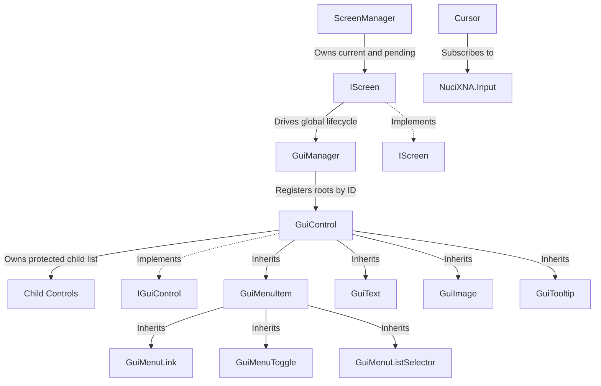
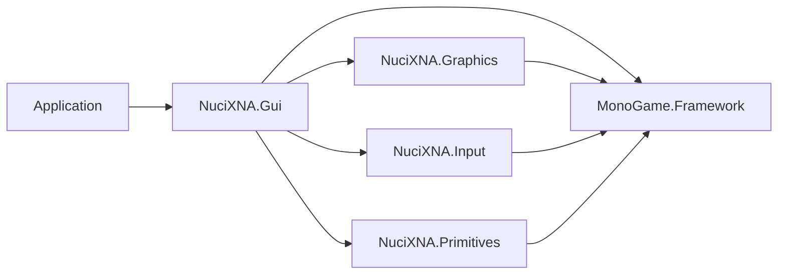

# Architecture

This document complements the root [ARCHITECTURE.md](../ARCHITECTURE.md) with detailed architectural information for NuciXNA.Gui.

## System Purpose

NuciXNA.Gui is a .NET class library providing retained GUI controls and screen management for MonoGame/XNA hosts. Controls retain state and parent-child relationships between frames; the host supplies `GameTime` and `SpriteBatch` to synchronous update and draw methods.

## Architectural Style

**Retained Controls with Singleton Coordinators**

The library uses:
- **Singleton coordination** for `GuiManager` and `ScreenManager`, with locked lazy construction.
- **Retained composition** in which controls preserve state and protected child collections across frames.
- **Template methods** in `GuiControl` and `Screen`: public lifecycle methods enforce state and invoke protected `Do*` hooks.
- **Event-driven input and lifecycle notifications** from `NuciXNA.Input`, controls, and screens.
- **Per-frame rendering** through MonoGame `SpriteBatch`; redrawing each frame does not make the control model immediate-mode.

## System Boundary



### Trust Boundaries

- **Application boundary:** The consuming application controls all data passed to controls (text, textures, layout)
- **Library boundary:** NuciXNA.Gui does not access network, filesystem, or external services
- **MonoGame boundary:** Rendering and input are provided by MonoGame; the library trusts MonoGame's state

## Component Relationships



## Dependency Direction



### Dependency Rules

- The library project depends on MonoGame, NuciXNA.Graphics, NuciXNA.Input, and NuciXNA.Primitives.
- Controls use NuciXNA graphics sprites/effects, input events, and primitive geometry.
- `Screen` drives `GuiManager`; `MenuScreen` and `GuiMenuLink` also use `ScreenManager`.
- `GuiManager` has no dependency on `ScreenManager`. `ScreenManager` reaches controls indirectly through the active screen's `GuiManager` lifecycle.
- `IGuiControl` and `IScreen` expose MonoGame, NuciXNA.Input, and NuciXNA.Primitives types, so they are not dependency-free boundaries.

## Key Invariants

1. `GuiManager.Instance` and `ScreenManager.Instance` each return one lazily constructed process-wide instance.
2. A loaded control or screen cannot be loaded again; update, draw, and unload require loaded content.
3. `Screen.LoadContent()` invokes the screen hook before loading every root registered in the global `GuiManager`.
4. Child controls inherit effective opacity, colours, font, enabled state, and visibility; size also falls back to the parent when unset.
5. Mouse click arbitration uses `InputManager.Instance.MouseButtonInputHandled`; root hit testing runs in reverse registration order and drawing runs in registration order.
6. A transition constructs the pending screen immediately, continues updating and drawing the old screen under a fade overlay, then disposes the old screen and loads the pending screen once the overlay is opaque.
7. Opacity assignments are clamped to the inclusive range `[0.0f, 1.0f]`.
8. Lifecycle events bracket their corresponding hook and manager operations as implemented; constructor-raised `Created` events occur before external subscribers can attach.

## Design Decisions

| Decision | Rationale | Consequence |
|----------|-----------|-------------|
| **Singleton Managers** | Simplifies access from anywhere in application; avoids passing manager references everywhere | Global state that complicates testing; tight coupling to manager classes |
| **Retained controls with per-frame drawing** | Controls preserve UI state while MonoGame requests a draw each frame | State and lifecycle ordering must remain coherent across frames |
| **Component-Based Controls** | Enables complex UIs through composition; follows established GUI patterns | Requires careful management of parent-child relationships; potential for deep hierarchies |
| **Event-Based Interaction** | Familiar .NET pattern; decouples controls from application logic | Potential for memory leaks if events not properly unsubscribed |
| **Dependency on NuciXNA.* Packages** | Leverages existing utility libraries; reduces code duplication | Creates ecosystem lock-in; requires consumers to use entire NuciXNA stack |
| **No Built-in Theming** | Keeps core library simple; allows applications to implement their own styling | Applications must duplicate styling logic; inconsistent look and feel across apps |
| **Template Method Pattern** | Provides consistent lifecycle management while allowing customization | Subclasses must remember to call base methods; can lead to fragile inheritance chains |
| **No Persistence** | GUI state is transient; matches game UI paradigm | Applications must manage their own UI state persistence |

## Runtime Topology

The public runtime methods are synchronous and intended to be called by the host's game loop. The repository contains no scheduler and does not enforce a frame rate.

```
Host game loop
├── Update(GameTime)
│   ├── ScreenManager.Update()
│   │   ├── current IScreen.Update()
│   │   │   ├── DoUpdate() (screen-specific)
│   │   │   └── GuiManager.Update()
│   │   │       ├── RemoveDisposedControls()
│   │   │       ├── HandleInput() for each control
│   │   │       └── Update() for each control
│   │   └── Transition logic (if transitioning)
│   └── base.Update()
└── Draw(GameTime)
    ├── ScreenManager.Draw(SpriteBatch)
    │   ├── current IScreen.Draw()
    │   │   ├── GraphicsDevice.Clear()
    │   │   ├── DoDraw() (screen-specific)
    │   │   └── GuiManager.Draw()
    │   │       └── Draw() for each visible control
    │   └── Transition sprite (if transitioning)
    └── base.Draw()
```

## State Management

All state is **transient and in-memory**:
- Control properties and selector values exist only in memory.
- `GuiManager` owns a dictionary of root controls keyed by `Id`; child controls remain owned by their parents.
- `ScreenManager` owns current and pending `IScreen` references plus the transition sprite.
- The repository contains no persistence, cache, network client, or serialisation layer. A host that needs persistence owns it.

## Error Handling

The library generally permits exceptions to cross its boundary:
- Lifecycle misuse raises `InvalidOperationException`.
- Duplicate or null control IDs fail through `Dictionary.Add`.
- Invalid list-selector indexes, keys, and values raise `IndexOutOfRangeException` or `ArgumentOutOfRangeException`; `TrySelectItem` suppresses only those documented lookup exceptions.
- Screen reflection, construction, cast, loading, graphics, and content failures are not translated.
- `GuiControl` and `Screen` implement idempotent explicit disposal guarded by `IsDisposed`; each also has a finalizer that calls `Dispose()`.