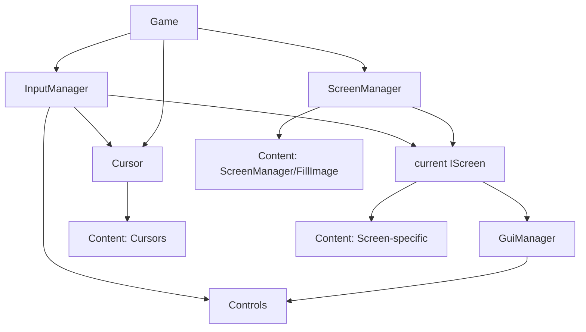

# Application Services

This document describes manager and host-facing service boundaries. Exact members are also indexed in [API Reference](../api-reference/INDEX.md).

## GuiManager

**Namespace:** `NuciXNA.Gui`
**Pattern:** Public class with a locked, lazily constructed `Instance`; the public constructor also permits additional instances.

### Purpose
Private root-control dictionary plus global control lifecycle, input polling, draw/update traversal, focus, and defaults.

### Singleton Access

```csharp
var manager = GuiManager.Instance;  // Lazy initialization on first access
```

### Key Responsibilities

1. **Root registry** - `Dictionary<string, GuiControl>` keyed by caller-settable `Id`.
2. **Lifecycle coordination** - Loads/unloads all roots; updates and draws eligible roots.
3. **Click arbitration** - Reverse root polling with the shared input handled flag.
4. **Focus arbitration** - Unfocuses focused roots and focuses a matching root ID.
5. **Defaults** - Colours, font name, texture layout, and an unused margins value.

### Public API

```csharp
public class GuiManager
{
    public static GuiManager Instance { get; }

    public Colour DefaultBackgroundColour { get; set; }
    public Colour DefaultForegroundColour { get; set; }
    public string DefaultFontName { get; set; }
    public TextureLayout DefaultTextureLayout { get; set; }
    public int DefaultMargins { get; set; }

    public GuiManager();
    public void LoadContent();
    public virtual void UnloadContent();
    public virtual void Update(GameTime gameTime);
    public virtual void Draw(SpriteBatch spriteBatch);
    public void RegisterControl(GuiControl control);
    public void RegisterControls(params GuiControl[] controls);
    public void RegisterControls(IEnumerable<GuiControl> controls);
    public void FocusControl(GuiControl control);
    public void FocusControl(string id);
}
```

### Control Registration

```csharp
var button = new GuiMenuLink { Text = "Start" };
GuiManager.Instance.RegisterControl(button);
```

There is no public collection, lookup, reordering, or unregister member. `Dictionary.Add` propagates duplicate/null-key errors. Disposed roots are removed at the start of the next update.

### Update Loop

```csharp
public void Update(GameTime gameTime)
{
    RemoveDisposedControls();
    List<GuiControl> controlValues = [.. guiControls.Values];
    // Reverse HandleInput traversal until handled, reset flag,
    // then forward Update traversal for loaded, enabled roots.
}
```

### Draw Loop

```csharp
public void Draw(SpriteBatch spriteBatch)
{
    foreach (GuiControl control in guiControls.Values)
    {
        if (control.IsContentLoaded && control.IsVisible)
        {
            control.Draw(spriteBatch);
        }
    }
}
```

### Default Styling

Controls inherit from `GuiManager.Instance` when no parent or explicit value:

```csharp
// Application can customize defaults at startup
GuiManager.Instance.DefaultFontName = "MyUIFont";
GuiManager.Instance.DefaultForegroundColour = Colour.Black;
GuiManager.Instance.DefaultBackgroundColour = new Colour(0.2f, 0.2f, 0.2f, 1.0f);
```

### Disposal

```csharp
public void UnloadContent()
{
    foreach (GuiControl control in guiControls.Values)
    {
        control.UnloadContent();
    }

    guiControls.Clear();
}
```

Unloading does not explicitly dispose roots. It recursively unloads their children and clears the manager registry.

---

## ScreenManager

**Namespace:** `NuciXNA.Gui.Screens`
**Pattern:** Public class with a locked, lazily constructed `Instance`; mutable state is not generally thread-safe.

### Purpose
Owns the private current/pending `IScreen` references and transition sprite.

### Singleton Access

```csharp
var manager = ScreenManager.Instance;
```

### Key Responsibilities

1. **Starting screen** - Reflects and loads `StartingScreenType`.
2. **Current screen** - Delegates synchronous update and draw.
3. **Transition** - Constructs a pending screen, overlays black, then disposes/swaps/loads at full opacity.
4. **Back-buffer size** - Caches `GraphicsManager.Instance.BackBufferSize` outside active transitions.

### Public API

```csharp
public class ScreenManager
{
    public static ScreenManager Instance { get; }

    public Type StartingScreenType { get; set; }
    public Size2D Size { get; private set; }
    public SpriteBatch SpriteBatch { get; set; }
    public bool Transitioning { get; private set; }

    public ScreenManager();
    public void LoadContent();
    public void UnloadContent();
    public void Update(GameTime gameTime);
    public void Draw(SpriteBatch spriteBatch);
    public void ChangeScreens<TScreen>() where TScreen : IScreen;
    public void ChangeScreens<TScreen>(params object[] parameters) where TScreen : IScreen;
    public void ChangeScreens(Type screenType);
    public void ChangeScreens(Type screenType, params object[] parameters);
}
```

### Screen Transition

```csharp
// Request transition (typically from menu item click)
ScreenManager.Instance.ChangeScreens(typeof(GameScreen));
ScreenManager.Instance.ChangeScreens<GameScreen>();
ScreenManager.Instance.ChangeScreens(typeof(GameScreen), levelId);
```

### Transition Implementation

```csharp
// TextureSprite: ScreenManager/FillImage, black tint, tiled layout.
// FadeEffect: speed 3, multiplier 0..2, increasing from 0.
// Swap when transitionSprite.ClientOpacity reaches 1.
```

### LoadContent Flow

```csharp
public void LoadContent()
{
    currentScreen = (IScreen)Activator.CreateInstance(StartingScreenType);
    transitionSprite = new TextureSprite
    {
        ContentFile = "ScreenManager/FillImage",
        Tint = Colour.Black,
        OpacityEffect = new FadeEffect
        {
            Speed = 3,
            CurrentMultiplier = 0.0f,
            MinimumMultiplier = 0.0f,
            MaximumMultiplier = 2.0f
        },
        TextureLayout = TextureLayout.Tile
    };
    currentScreen.LoadContent();
    transitionSprite.LoadContent();
}
```

### Change Screen Flow

```csharp
Request -> construct pending screen -> activate overlay -> keep old screen active
-> at opaque dispose old screen -> assign/load pending screen -> deactivate overlay
```

Requests while `Transitioning` are ignored. The pending screen is not loaded, updated, or drawn before the opaque swap. See [Screen Transitions](../flows/screen-transitions.md).

---

## Cursor

**Namespace:** `NuciXNA.Gui`
**Pattern:** Host-constructed sealed class; not a singleton and not managed by `GuiManager`.

### Purpose
Custom mouse cursor rendering with idle/click states.

### Construction

```csharp
var cursor = new Cursor();
```

### Public API

```csharp
public sealed class Cursor
{
    public Point2D Location { get; set; }
    public Point2D LocationOffset { get; set; }
    public ButtonState State { get; set; }
    public int Frames { get; set; }
    public Size2D SpriteSize { get; set; }
    public Scale2D Scale { get; set; }
    public string ContentFile { get; set; }

    public Cursor();
    public void LoadContent();
    public void UnloadContent();
    public void Update(GameTime gameTime);
    public void Draw(SpriteBatch spriteBatch);
}
```

### Integration

```csharp
cursor.LoadContent();
cursor.Update(gameTime);
cursor.Draw(spriteBatch);
cursor.UnloadContent();
```

### Content Requirements

| Asset | Path | Description |
|-------|------|-------------|
| Idle texture | `Cursors/idle` | Default cursor appearance |
| Click texture | `Cursors/click` | Cursor when left mouse button held |

Those two assets apply when `ContentFile` is empty at load. A non-empty value at load uses one sprite and no button-state subscriptions. Changing `ContentFile` while loaded reloads only the idle sprite and does not reconcile click sprite/subscriptions from the original mode.

---

## InputManager (from NuciXNA.Input)

**Namespace:** `NuciXNA.Input`
**Pattern:** Singleton

### Purpose
External singleton used for input events, mouse state queries, and the shared click-arbitration flag.

### Integration

This repository does not invoke or document the external manager's update method. The host must satisfy the NuciXNA.Input lifecycle independently.

### Events Provided

| Event | Description |
|-------|-------------|
| `KeyboardKeyHeldDown` / `KeyboardKeyPressed` / `KeyboardKeyReleased` | Control keyboard events |
| `MouseButtonPressed` / `MouseButtonReleased` | Mouse buttons |
| `MouseMoved` | Mouse position change |
| `GamepadButtonHeldDown` / `GamepadButtonPressed` / `GamepadButtonReleased` | Control/screen gamepad events |

### GuiManager Integration

Loaded controls/screens subscribe directly to events. Separately, `GuiManager.Update` calls `GuiControl.HandleInput()` in reverse root order to poll left clicks by bounds. See [Input Handling](../flows/input-handling.md).

---

## Service Initialization Order

```csharp
protected override void LoadContent()
{
    spriteBatch = new SpriteBatch(GraphicsDevice);

    GuiManager.Instance.DefaultFontName = "Fonts/UIFont";

    cursor = new Cursor();
    cursor.LoadContent();

    ScreenManager.Instance.StartingScreenType = typeof(MainMenuScreen);
    ScreenManager.Instance.LoadContent();
    base.LoadContent();
}

protected override void Update(GameTime gameTime)
{
    // Advance NuciXNA.Input according to its package contract.
    cursor.Update(gameTime);
    ScreenManager.Instance.Update(gameTime);
    base.Update(gameTime);
}

protected override void Draw(GameTime gameTime)
{
    spriteBatch.Begin();
    ScreenManager.Instance.Draw(spriteBatch);
    cursor.Draw(spriteBatch);
    spriteBatch.End();
    base.Draw(gameTime);
}

protected override void UnloadContent()
{
    ScreenManager.Instance.UnloadContent();
    cursor.UnloadContent();
    base.UnloadContent();
}
```

---

## Service Dependencies



---

## Testing Services

### Singleton Isolation

There is no test-only reset API for either static `Instance`. Constructors are public, but production classes still refer to static instances, so alternate objects are not complete substitutes. `GuiManager.UnloadContent()` can clear a populated instance only when its roots are in a valid loaded state; `ScreenManager.UnloadContent()` assumes a current screen and transition sprite exist.

### Mocking Services

The test project provides [`DummyControl`](../../NuciXNA.Gui.UnitTests/Helpers/DummyControl.cs) and [`DummyScreen`](../../NuciXNA.Gui.UnitTests/Helpers/DummyScreen.cs) for base lifecycle tests.

```csharp
var control = new DummyControl();
var screen = new DummyScreen();
```

There are no focused `GuiManager`, `ScreenManager`, transition, input-order, or cursor tests in the current test project.

---

## Configuration

### GuiManager Defaults

| Property | Default | Typical Override |
|----------|---------|------------------|
| `DefaultBackgroundColour` | `Colour.Transparent` | Base control/screen fallback |
| `DefaultForegroundColour` | `Colour.Black` | Base control/screen fallback |
| `DefaultFontName` | `"DefaultFont"` | Base control fallback |
| `DefaultTextureLayout` | `TextureLayout.Stretch` | `GuiImage` fallback |
| `DefaultMargins` | `8` | Currently unused in production source |

### ScreenManager Configuration

| Property | Default | Description |
|----------|---------|-------------|
| `StartingScreenType` | `null` | Must be a constructible `IScreen` type before `LoadContent()` |
| `SpriteBatch` | `null` | Public property currently unused internally |

### Cursor Configuration

Constructed cursor properties configure location, offset, state, frame metadata, sprite size, scale, and optional single-sprite `ContentFile`. Empty content file uses conventional paired paths.

See [Configuration](../configuration.md) for precedence and asset details.

---

## Error Handling

### Common Exceptions

| Scenario | Exception | Resolution |
|----------|-----------|------------|
| Null or invalid `StartingScreenType` | Reflection or cast exception propagates | Supply a constructible `IScreen` type |
| Target constructor parameters do not match | Reflection exception propagates from `ChangeScreens` | Match the target constructor exactly |
| Duplicate/null root ID | Dictionary exception propagates from registration | Preserve unique, non-null root IDs |
| Control/screen loaded twice | `InvalidOperationException` | Balance lifecycle calls |
| Control/screen update, draw, or unload before load | `InvalidOperationException` | Load first |
| Invalid selector index/key/value | `IndexOutOfRangeException` or `ArgumentOutOfRangeException` | Validate or use the matching tolerant selector overload |
| Transition requested while active | No exception; request is ignored | Queue at host level if required |
| Graphics/content failure | Dependency exception propagates | Diagnose the content identifier and external graphics setup |

### Fail-Fast Principles

- Control and screen base lifecycles validate loaded state.
- Managers perform little explicit argument/state validation and generally permit dependency exceptions to propagate.
- `TrySelectItem` suppresses only its documented invalid index/value exception.
- `ChangeScreens` deliberately returns silently while a transition is active.