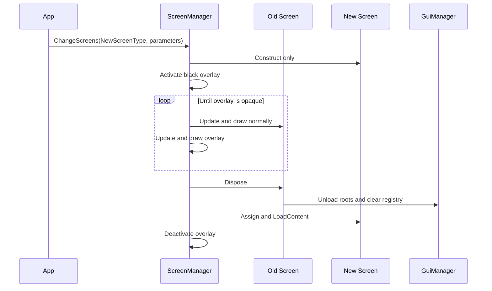

# Host and Composition

This document describes how NuciXNA.Gui integrates with the host application (MonoGame Game class) and how components are composed at runtime.

## Application Integration

### Minimal Integration

```csharp
public class MyGame : Game
{
    private SpriteBatch spriteBatch;
    private Cursor cursor;

    protected override void LoadContent()
    {
        spriteBatch = new SpriteBatch(GraphicsDevice);

        cursor = new Cursor();
        cursor.LoadContent();

        ScreenManager.Instance.StartingScreenType = typeof(MainMenuScreen);
        ScreenManager.Instance.LoadContent();
        base.LoadContent();
    }

    protected override void Update(GameTime gameTime)
    {
        // Advance NuciXNA.Input according to that package's host contract.
        cursor.Update(gameTime);
        ScreenManager.Instance.Update(gameTime);
        base.Update(gameTime);
    }

    protected override void Draw(GameTime gameTime)
    {
        spriteBatch.Begin();
        ScreenManager.Instance.Draw(spriteBatch);
        cursor.Draw(spriteBatch);
        spriteBatch.End();
        base.Draw(gameTime);
    }

    protected override void UnloadContent()
    {
        ScreenManager.Instance.UnloadContent();
        cursor.UnloadContent();
        base.UnloadContent();
    }
}
```

### Required Call Order

| Phase | Required Calls | Order |
|-------|----------------|-------|
| **LoadContent** | Set `StartingScreenType`, then call `ScreenManager.LoadContent()` | Before update/draw |
| | Construct and load an optional `Cursor` | Independent of screen manager |
| **Update** | Advance NuciXNA.Input per its own contract | Before relying on current input state/events |
| | Call `Cursor.Update(gameTime)` and `ScreenManager.Update(gameTime)` | Host-selected relative order |
| **Draw** | `spriteBatch.Begin()` | First |
| | `ScreenManager.Instance.Draw(spriteBatch)` | After begin |
| | Optional `cursor.Draw(spriteBatch)` | Host-selected layer; after manager draws on top |
| | `spriteBatch.End()` | Last |
| **UnloadContent** | `ScreenManager.Instance.UnloadContent()` | First |
| | `cursor.UnloadContent()` | Balance cursor load |

---

## ScreenManager Composition

### Responsibilities
- Constructs and loads the starting `IScreen`.
- Updates and draws the private current screen.
- Constructs a private pending screen for transitions.
- Draws the black transition overlay and swaps screens at full opacity.
- Tracks the back-buffer `Size` outside active transitions.

### Key Properties

| Property | Type | Description |
|----------|------|-------------|
| `Instance` | `ScreenManager` | Singleton instance |
| `StartingScreenType` | `Type` | Type reflected during `LoadContent()` |
| `Size` | `Size2D` | Current cached back-buffer size; private setter |
| `SpriteBatch` | `SpriteBatch` | Public host-settable property; not read internally |
| `Transitioning` | `bool` | Read-only outside the manager |

### Screen Transition Flow



See [Screen Transitions](../flows/screen-transitions.md) for exact branches and failure semantics.

### Screen Registration

Screens register their controls with `GuiManager` during `Screen.LoadContent()`:

```csharp
public sealed class MainMenuScreen : Screen
{
    protected override void DoLoadContent()
    {
        GuiMenuLink link = new()
        {
            Text = "Start",
            TargetScreen = typeof(GameScreen)
        };

        GuiManager.Instance.RegisterControl(link);
    }

    protected override void DoUnloadContent() { }
    protected override void DoUpdate(GameTime gameTime) { }
    protected override void DoDraw(SpriteBatch spriteBatch) { }
}
```

`Screen.LoadContent()` invokes `DoLoadContent()` before `GuiManager.LoadContent()`, so roots registered in the hook are loaded immediately afterwards.

---

## GuiManager Composition

### Responsibilities
- Stores root controls in a private dictionary keyed by `Id`.
- Loads/unloads every root when the active screen drives the manager lifecycle.
- Removes roots already marked disposed at the start of update.
- Arbitrates polled mouse clicks in reverse root-snapshot order.
- Updates loaded/enabled roots and draws loaded/visible roots.
- Supplies global colours, font, texture layout, and a currently unused margins value.

### Key Properties

| Property | Type | Description |
|----------|------|-------------|
| `Instance` | `GuiManager` | Singleton instance |
| `DefaultBackgroundColour` | `Colour` | Default background (Transparent) |
| `DefaultForegroundColour` | `Colour` | Default foreground (Black) |
| `DefaultFontName` | `string` | Default font ("DefaultFont") |
| `DefaultTextureLayout` | `TextureLayout` | Default image layout (`Stretch`) |
| `DefaultMargins` | `int` | Defaults to `8`; no production consumer |

### Control Registration

```csharp
GuiManager.Instance.RegisterControl(control);
GuiManager.Instance.RegisterControls(first, second);
GuiManager.Instance.RegisterControls(controlEnumerable);
```

Registration uses `Dictionary.Add`; duplicate or null IDs fail through dictionary exceptions. There is no public controls collection, lookup, or unregister API. Disposing a root marks it for removal on the next update; unloading a screen clears the complete registry.

### Update/Draw Delegation

`ScreenManager` calls only the current `IScreen`. The base `Screen` then calls `GuiManager` after its own hook:

```csharp
// In ScreenManager.Update()
currentScreen.Update(gameTime);  // Screen.Update calls GuiManager.Update()

// In ScreenManager.Draw()
currentScreen.Draw(spriteBatch); // Screen.Draw calls GuiManager.Draw()
```

---

## Screen Composition

### Screen Base Class

```csharp
public abstract class Screen : IScreen
{
    public void LoadContent() { /* lifecycle orchestration */ }
    public void UnloadContent() { /* lifecycle orchestration */ }
    public void Update(GameTime gameTime) { /* lifecycle orchestration */ }
    public void Draw(SpriteBatch spriteBatch) { /* lifecycle orchestration */ }

    protected abstract void DoLoadContent();
    protected abstract void DoUnloadContent();
    protected abstract void DoUpdate(GameTime gameTime);
    protected abstract void DoDraw(SpriteBatch spriteBatch);
}
```

The non-virtual public methods enforce loaded-state rules, raise lifecycle events, subscribe/unsubscribe screen input, and call `GuiManager`. The class exposes no screen-owned control list; roots are global to `GuiManager` for the loaded screen.

### MenuScreen Composition

`MenuScreen` extends `Screen` with menu-specific composition:

```csharp
public class MenuScreen : Screen
{
    public MenuScreenAxis Axis { get; set; } = MenuScreenAxis.Vertical;
    public int Spacing { get; set; } = 32;
    public List<GuiMenuItem> Items { get; set; } = [];
    public int SelectedItemIndex { get; private set; }
}
```

`DoLoadContent` registers every item as a root, centres/spaces them, and attaches menu handlers to screen events. Directional keyboard/gamepad input wraps the index and skips items whose `IsSelectable` is false; mouse movement selects a selectable item under the pointer. `DoUpdate` realigns items and focuses a newly normalised index.

### Control Hierarchy Within Screens

```
Screen (MenuScreen)
├── GuiMenuItem (GuiMenuLink) "Start Game"
│   └── GuiText "Start Game"
├── GuiMenuItem (GuiMenuToggle) "Fullscreen: On"
│   └── GuiText "Fullscreen: On"
├── GuiMenuItem (GuiMenuListSelector) "Difficulty"
│   └── GuiText "Difficulty: Normal"
└── GuiMenuItem (GuiMenuLink) "Exit"
    └── GuiText "Exit"
```

---

## Control Composition

### Parent-Child Relationships

Controls form a tree through protected `GuiControl.RegisterChild` and `RegisterChildren`. There is no public `Children` collection.

```csharp
public sealed class LabelledImage : GuiControl
{
    private GuiImage image;
    private GuiText label;

    protected override void DoLoadContent()
    {
        image = new GuiImage { ContentFile = "UI/Icon" };
        label = new GuiText { Text = "Save" };
        RegisterChildren(image, label);
    }

    protected override void DoUnloadContent() { }
    protected override void DoUpdate(GameTime gameTime) { }
    protected override void DoDraw(SpriteBatch spriteBatch) { }
}
```

Registration both appends children and sets their `Parent`. Assigning `Parent` directly does not add a control to the parent's private child list and therefore does not give it child lifecycle traversal.

### Property Inheritance in Composition

When a control is added as a child, it inherits properties from its parent:

```csharp
// Inside a composite control after RegisterChild(label):
BackgroundColour = Colour.Blue;
Opacity = 0.8f;
FontName = "Fonts/UIFont";

// label resolves those effective values while its own values remain unset.
```

Background/foreground colour, font, opacity, effective enabled/visible state, location, and unset size interact with ancestry. Texture layout and text margins have separate concrete-control rules.

### Composite Controls

Controls can contain other controls for complex UI:

```text
GuiText       -> child GuiImage background + owned TextSprite
GuiMenuItem   -> child GuiText
GuiTooltip    -> child border GuiImage + background GuiImage + GuiText
```

`GuiImage`, `TextSprite`, and `TextureSprite` wrappers own their NuciXNA.Graphics content lifecycle. Parent controls create these collaborators in `DoLoadContent` before the base `GuiControl.LoadContent` method loads registered children.

---

## Content Management

### Content Resolution

Public lifecycle methods are parameterless. Controls pass content identifiers into NuciXNA.Graphics wrappers, which own actual resolution/loading.

```csharp
cursor.LoadContent();
ScreenManager.Instance.LoadContent();

GuiManager.Instance.DefaultFontName = "Fonts/UIFont";
image.ContentFile = "UI/Button";
```

### Content Paths

| Component | Content Paths |
|-----------|---------------|
| `Cursor` | `"Cursors/idle"`, `"Cursors/click"` |
| `ScreenManager` transition | `"ScreenManager/FillImage"` |
| `GuiText` | `ScreenManager/FillImage` plus effective `FontName` |
| `GuiMenuItem` | `MenuFont` via its child `GuiText` |
| `GuiTooltip` | `ScreenManager/FillImage` and `MenuFont` |
| `GuiImage` | Application-defined `ContentFile` and optional `MaskFile` |

---

## Dependency Injection Alternative

`GuiManager` and `ScreenManager` constructors are public, but production controls and screens directly call their static `Instance` properties. Creating alternate manager instances therefore does not substitute those internal dependencies coherently.

`Cursor` is the exception: it has no singleton and is naturally host-owned. Introducing dependency injection for managers would require source changes that replace static access throughout controls/screens and define manager lifetimes explicitly.

---

## Multi-Screen Applications

`ScreenManager` owns one loaded current screen and, while transitioning, one constructed but unloaded pending screen. `GuiMenuLink` supplies target type and constructor arguments. Requests during a transition are ignored.

### Screen State Preservation

The old screen is disposed before the pending screen is loaded. Persistent gameplay/settings state must therefore live outside disposable screen/control objects, for example in a host-owned model passed through constructor parameters.

```csharp
public sealed class GameScreen(GameState gameState) : Screen
{
    protected override void DoLoadContent()
    {
        // Build controls from host-owned gameState.
    }

    protected override void DoUnloadContent() { }
    protected override void DoUpdate(GameTime gameTime) { }
    protected override void DoDraw(SpriteBatch spriteBatch) { }
}
```

---

## Threading Model

The library creates no asynchronous work; all methods and event handlers run synchronously on their caller. Singleton construction is locked, but mutable manager/control state is not generally thread-safe. See [Concurrency and Scheduling](../concurrency-and-scheduling.md).

---

## Disposal and Cleanup

### Application Shutdown

```csharp
protected override void UnloadContent()
{
    ScreenManager.Instance.UnloadContent();
    cursor.UnloadContent();
    base.UnloadContent();
}
```

### Control Disposal

```csharp
control.Dispose();
// GuiManager removes a disposed registered root at the next Update().
```

### Resource Cleanup Order

1. `ScreenManager.UnloadContent()` disposes the current screen and unloads the transition sprite.
2. `Screen.Dispose()` invokes `Screen.UnloadContent()` when loaded.
3. `Screen.UnloadContent()` runs its hook, then `GuiManager.UnloadContent()`.
4. `GuiManager.UnloadContent()` unloads every root and clears the dictionary; it does not explicitly dispose roots.
5. Each root unload recursively unloads and clears children.
6. `Cursor.UnloadContent()` unloads its sprite wrappers and unsubscribes events.