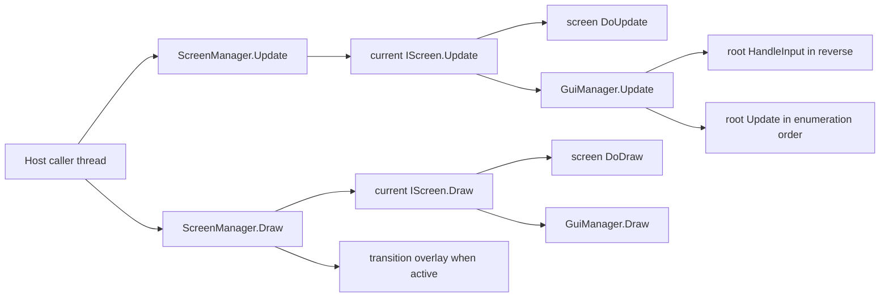

# Concurrency and Scheduling

This document distinguishes the concurrency guarantees implemented by NuciXNA.Gui from host responsibilities that the repository does not enforce.

## Threading Model

The library creates no worker threads, tasks, timers, queues, or schedulers. Every lifecycle method and event handler runs synchronously on the thread that invokes it. A conventional MonoGame host therefore calls the library on its game thread, but the repository does not inspect or enforce thread identity.



### Guarantees

- Production code contains no asynchronous API or internally scheduled work.
- `GuiManager.Instance` and `ScreenManager.Instance` serialise lazy construction with `System.Threading.Lock`.
- The root-control dictionary, screen references, control child lists, selectors, and cursor fields have no general synchronisation.
- `GuiControl.Dispose(bool)` and `Screen.Dispose(bool)` lock the object instance during disposal; that does not make other methods thread-safe.

### Implications

| Aspect | Implication |
|--------|-------------|
| **Content loading** | Executes synchronously on the caller and can propagate dependency failures. |
| **Events** | Execute synchronously on the thread used by `InputManager` or the lifecycle caller. |
| **Graphics** | Draw and graphics-device operations must satisfy MonoGame/NuciXNA.Graphics thread requirements. |
| **Mutation** | Concurrent registration, update, drawing, parenting, or selection is unsupported by this repository. |
| **Host policy** | A host should serialise lifecycle calls; this is an integration requirement, not an enforced guard. |

## Game Loop Integration

NuciXNA.Gui does not select a frame rate, fixed timestep, vertical synchronisation mode, or draw cadence. The host decides when to invoke update and draw.

```csharp
private readonly Cursor cursor = new();

protected override void Update(GameTime gameTime)
{
    // Update NuciXNA.Input according to that package's host contract.
    cursor.Update(gameTime);
    ScreenManager.Instance.Update(gameTime);
    base.Update(gameTime);
}

protected override void Draw(GameTime gameTime)
{
    spriteBatch.Begin();
    ScreenManager.Instance.Draw(spriteBatch);
    cursor.Draw(spriteBatch);
    spriteBatch.End();
    base.Draw(gameTime);
}
```

### Timing Guarantees

| Method | Called | Timing |
|--------|--------|--------|
| Method | Repository requirement |
|--------|------------------------|
| `LoadContent()` | Required before update, draw, or unload for screens and controls. |
| `Update(GameTime)` | Synchronous; cadence belongs to the host. |
| `Draw(SpriteBatch)` | Synchronous; cadence and `SpriteBatch.Begin`/`End` ownership belong to the host. |
| `UnloadContent()` | Valid only while loaded. `Dispose()` invokes it automatically when required. |

## Scheduling Within Frame

### Update Phase Order

1. `ScreenManager.Update` invokes the current screen's `Update` unconditionally.
2. `Screen.Update` raises `Updating`, invokes `DoUpdate`, invokes `GuiManager.Update`, then raises `Updated`.
3. `GuiManager.Update` removes disposed roots and copies dictionary values to a snapshot.
4. It traverses that snapshot in reverse for `HandleInput`, stopping when `InputManager.MouseButtonInputHandled` is true.
5. It resets the shared handled flag to false.
6. It traverses the snapshot forwards and updates each loaded, enabled root.
7. If a screen transition is active, `ScreenManager` then updates the transition sprite and may swap screens.

### Draw Phase Order

1. `ScreenManager.Draw` invokes the current screen's `Draw`.
2. `Screen.Draw` raises `Drawing`, clears the graphics device with the colour captured during load, invokes `DoDraw`, invokes `GuiManager.Draw`, then raises `Drawn`.
3. `GuiManager.Draw` enumerates roots and draws those that are loaded and visible.
4. Each `GuiControl.Draw` invokes `DoDraw` before recursively drawing enabled, visible children.
5. During a transition, `ScreenManager` draws the transition sprite after the old screen. The pending screen is not drawn.
6. Cursor draw order is entirely host-controlled because `Cursor` is independent of both managers.

## Control Update Scheduling

### Root Traversal

`GuiManager` stores roots in a `Dictionary<string, GuiControl>` and snapshots `guiControls.Values` before input/update traversal. Input uses indexes from the last snapshot value to the first; updates enumerate the snapshot forwards. Code should not use dictionary order as a public z-order contract because the API exposes neither ordering nor reordering operations.

### Parent-Child Update Order

`GuiControl.Update` first removes null or disposed children in reverse, restores each surviving child's `Parent`, invokes the parent's `DoUpdate`, and then updates enabled children in child-list order.

```csharp
public void Update(GameTime gameTime)
{
    // State validation and child cleanup occur first.
    DoUpdate(gameTime);

    foreach (GuiControl child in children)
    {
        if (child.IsEnabled)
        {
            child.Update(gameTime);
        }
    }
}
```

### Update Order Summary

```
GuiManager root snapshot (forward enumeration)
    Control A
        Control A.DoUpdate()
        Control A children (list order, enabled only)
            Child A1
                Child A1.DoUpdate()
                Child A1.Children...
            Child A2...
    Control B
        Control B.DoUpdate()
        Control B.Children...
```

---

## Draw Scheduling

### Root Draw Traversal

`GuiManager.Draw` enumerates dictionary values and calls `Draw` for each loaded, visible root. Disabled roots are still drawn; `GuiControl.Draw` filters children by both enabled and visible state.

```csharp
// In GuiManager.Draw()
foreach (GuiControl control in guiControls.Values)
{
    if (control.IsContentLoaded && control.IsVisible)
    {
        control.Draw(spriteBatch);
    }
}
```

### Parent-Child Draw Order

The parent `DoDraw` hook runs before child traversal. Enabled, visible children then draw recursively in child-list order.

```csharp
// In GuiControl.Draw()
public void Draw(SpriteBatch spriteBatch)
{
    DoDraw(spriteBatch);

    foreach (GuiControl child in children)
    {
        if (child.IsEnabled && child.IsVisible)
        {
            child.Draw(spriteBatch);
        }
    }
}
```

### Draw Order Summary

```
GuiManager dictionary-value enumeration
    Control A
        Control A.DoDraw()
        Control A children (list order, enabled and visible)
            Child A1
                Child A1.DoDraw()
                Child A1.Children...
            Child A2...
    Control B
        Control B.DoDraw()
        Control B.Children...
```

---

## Screen Transition Scheduling

Only the current (old) screen participates while the overlay is becoming opaque. The pending screen exists but remains unloaded.

```csharp
public void Update(GameTime gameTime)
{
    currentScreen.Update(gameTime);

    if (Transitioning)
    {
        Transition(gameTime);
        return;
    }

    // Refresh transition overlay size outside transitions.
}

public void Draw(SpriteBatch spriteBatch)
{
    currentScreen.Draw(spriteBatch);

    if (Transitioning)
    {
        transitionSprite.Draw(spriteBatch);
    }
}
```

### Transition Timing

| Condition | Current Screen | Pending Screen | Overlay |
|-----------|----------------|----------------|---------|
| Transition requested | Remains loaded | Constructed only | Activated from multiplier `0.0f` and increasing |
| Overlay opacity below `1.0f` | Updated and drawn | Not loaded, updated, or drawn | Updated and drawn after current screen |
| Overlay opacity reaches `1.0f` | Disposed | Assigned and loaded | Deactivated; transition ends |

Fade duration is an effect of `GameTime` and the hard-coded `FadeEffect.Speed = 3`; no duration guarantee is published.

## Input Scheduling

### External Input Lifecycle

This repository neither calls nor documents the implementation of `InputManager.Update`. The host must initialise and advance NuciXNA.Input according to that package's contract before relying on current-state queries or events.

### Input Event Timing

Loaded objects subscribe directly to `InputManager` events:
- `Screen` forwards pressed key, pressed mouse button, mouse movement, and pressed gamepad button events.
- `GuiControl` forwards focused keyboard/gamepad events plus pointer events filtered by enabled, visible, and display-rectangle state.
- `Cursor` tracks mouse movement and, in paired-sprite mode, left-button state.
- `GuiManager.Update` additionally performs reverse-order root click polling through `HandleInput` and resets `MouseButtonInputHandled` before root updates.

The external input manager decides when its events occur relative to the host's `ScreenManager.Update` call.

## Resource Loading Scheduling

### Content Loading Phase

```csharp
protected override void LoadContent()
{
    spriteBatch = new SpriteBatch(GraphicsDevice);

    cursor = new Cursor();
    cursor.LoadContent();

    ScreenManager.Instance.StartingScreenType = typeof(MainMenuScreen);
    ScreenManager.Instance.LoadContent();
    base.LoadContent();
}
```

### Loading Characteristics

- All lifecycle calls are synchronous and complete or throw before returning.
- `ScreenManager.LoadContent` constructs the starting `IScreen`, constructs/configures the transition sprite, loads the screen, and then loads the transition sprite.
- `Screen.LoadContent` invokes `DoLoadContent` first so the screen can register roots, then invokes `GuiManager.LoadContent` to load every registered root.
- `GuiControl.LoadContent` registers input events, invokes `DoLoadContent`, and then loads children.
- `Cursor` is independent; the host chooses its ordering relative to screen loading.
- No lifecycle method accepts a `ContentManager`, reports progress, or performs background loading.

## Disposal Scheduling

### Screen Transition Disposal

When overlay opacity reaches `1.0f`, `ScreenManager.Transition` synchronously:
1. Calls `currentScreen.Dispose()`.
2. `Screen.Dispose` calls `Screen.UnloadContent` when loaded.
3. `Screen.UnloadContent` unsubscribes screen events, invokes `DoUnloadContent`, and calls `GuiManager.UnloadContent`.
4. `GuiManager.UnloadContent` unloads all roots and clears its dictionary; it does not explicitly dispose those roots.
5. The manager assigns the pending screen to `currentScreen` and invokes its `LoadContent()`.
6. It deactivates the overlay and sets `Transitioning` to false.

If pending-screen loading throws, the old screen has already been disposed and the transition flags are not reset by a recovery path.

### Application Shutdown Disposal

```csharp
protected override void UnloadContent()
{
    ScreenManager.Instance.UnloadContent();
    cursor.UnloadContent();
    base.UnloadContent();
}
```

`ScreenManager.UnloadContent` disposes the current screen and unloads the transition sprite. It does not clear its screen fields or expose an `IsContentLoaded` guard.

## Concurrency Anti-Patterns

| Anti-Pattern | Problem | Solution |
|--------------|---------|----------|
| Concurrent manager mutation and update/draw | Dictionaries and lists are not synchronised | Serialise all lifecycle work on the host's graphics/game thread |
| Starting update/draw before load completes | Lifecycle guards throw or graphics state is incomplete | Complete synchronous loading first |
| Re-entering transition requests | `ChangeScreens` ignores requests while `Transitioning` | Queue such intent in the host if required |
| Disposing a root without another manager update | The disposed root remains in the dictionary until `RemoveDisposedControls` runs | Permit a subsequent `GuiManager.Update` or unload the screen |
| Concurrent disposal and event delivery | Object-level disposal locks do not protect event handlers or collections | Stop input/lifecycle delivery before disposal |

---

## Disposed Root Removal

There is no `UnregisterControl` API. A caller may dispose a registered root; the next `GuiManager.Update` removes entries whose control has `IsDisposed == true` before taking its traversal snapshot.

```csharp
private void RemoveDisposedControls()
{
    // Collect disposed IDs, then remove them after dictionary enumeration.
}
```

This two-pass implementation prevents mutation during the dictionary scan. `GuiManager.UnloadContent` instead unloads all roots and clears the dictionary immediately.

## Performance Scheduling

The repository contains no benchmarks, profiling artefacts, frame budget, or measured per-control costs. Supported structural observations are:
- Each manager update snapshots all roots, scans roots for input in reverse until handled, then scans all roots again for updates.
- Each root update and draw recursively traverses eligible descendants.
- Screen transitions add one transition-sprite update and draw while retaining the normal current-screen work.
- Hiding a root skips manager drawing but does not skip manager update; disabling a root skips input and update but does not by itself skip root drawing.

Performance claims require measurement in the consuming host with its actual hierarchy, assets, effects, `SpriteBatch` settings, and target hardware.

## Testing Scheduling

Tests invoke lifecycle methods synchronously. The repository does not configure a custom NUnit parallelisation policy or a scheduler. Existing tests concentrate on control/screen lifecycle, properties, selectors, toggles, links, and events; they do not exercise concurrent access, manager input order, cursor behaviour, or screen transitions.

## Summary

| Characteristic | Value |
|----------------|-------|
| **Internal scheduling** | None; all work is synchronous on the caller thread |
| **Thread safety** | Locked singleton construction and object-level disposal only |
| **Update/draw cadence** | Host-owned; no frame-rate guarantee |
| **Root input order** | Reverse manager snapshot until the shared handled flag is set |
| **Root update/draw order** | Forward dictionary-value enumeration; not exposed as an ordering contract |
| **Child order** | Parent hook first, then eligible children in child-list order |
| **Transition work** | Current screen plus overlay; pending screen loads only at the opaque swap point |
| **Content loading** | Synchronous and exception-transparent |
| **Root removal** | Disposed roots removed at the next manager update; full registry cleared on screen unload |