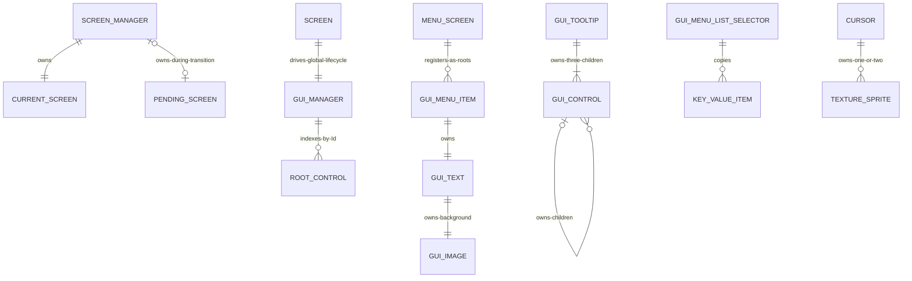
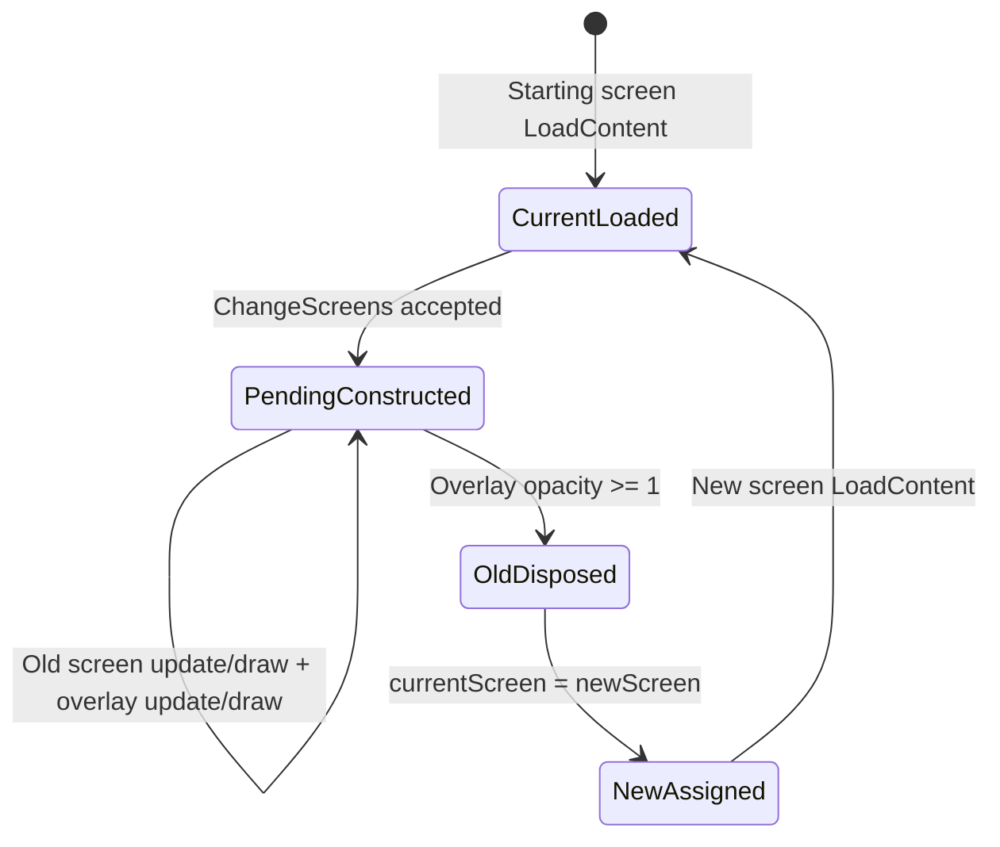

# Data Model

## Scope

NuciXNA.Gui has no database or serialised domain model. Its data model is an in-memory object graph of screens, root controls, control children, graphics wrappers, menu state, and input/lifecycle events.

## Entity Relationships

## Principal Models

| Model | Owner | Identity Or Key | Mutable State | Lifetime |
|-------|-------|-----------------|---------------|----------|
| `ScreenManager` | Static `Instance` or explicit caller | Object identity | Current/pending screen, transition sprite, size, transition flag | Process/instance lifetime |
| `Screen` | ScreenManager | Public replaceable GUID-string `Id` | Colours, loaded/disposed state, derived state | Until transition/shutdown disposal |
| `GuiManager` | Static `Instance` or explicit caller | Object identity | Root dictionary and defaults | Process/instance lifetime |
| Root `GuiControl` | GuiManager dictionary | Public `Id` string | Layout, appearance, state, private children | Screen lifecycle or caller disposal |
| Child `GuiControl` | Parent private list | Public `Id`, not globally indexed | Same base state | Parent lifecycle |
| `MenuScreen` | ScreenManager | Screen ID | Item list, axis, spacing, selected index | Screen lifetime |
| `GuiMenuListSelector` | Control owner | Dictionary keys plus enumeration index | Copied items and selected index/key/value | Control lifetime |
| `Cursor` | Host | Object identity | Location, state, asset mode, size/scale | Host-defined |
| `ListSelectionEventArgs` | Selector event invocation | None | Mutable selected index/key/value payload | One synchronous event delivery unless retained |

## Control Geometry And Effective Values

- `Location` is relative to `Parent`.
- `ScreenLocation` recursively sums ancestor locations.
- `ClientRectangle` uses local location; `DisplayRectangle` uses screen location.
- Unset `Size` inherits parent size, otherwise empty.
- Unset colours/font inherit through ancestors and then manager defaults.
- Unset opacity inherits through ancestors and then `1.0f`.
- Parent disabled/hidden state gates descendants without mutating descendant local flags.

There is no transform matrix, clipping region, layout container abstraction, z-index, or public child collection.

## Root Registry

`GuiManager` uses `Dictionary<string, GuiControl>.Add`:
- IDs must be non-null and unique at registration time.
- Publicly changing `Id` after registration does not re-key the dictionary.
- Descendants are not in the dictionary.
- Disposed roots remain indexed until the next manager update removes them.
- Screen unload unloads every root and clears the complete dictionary.

## Selector Collection

`GuiMenuListSelector` copies inputs into a dictionary. Index selection depends on dictionary enumeration order. String-only inputs receive generated GUID-string keys. `GetItems()` returns a defensive copy, while `Keys` and `Values` expose enumerable views of the current internal dictionary.

Replacing items raises `ItemsChanged`, resets selection fields, and automatically selects index `0` when non-empty, raising `SelectedItemChanged`.

## Screen State Transition

The pending screen is not loaded before the old screen is disposed. A pending load failure therefore leaves no loaded old-screen fallback.

## Persistence And Consistency

No state is persisted, cached externally, migrated, replicated, or transacted. Consistency is immediate within the caller thread except for disposed-root removal, which is deferred until manager update. Events execute synchronously and can observe/mutate state before later subscribers or subsequent lifecycle steps.

## Change Impact

Changes to ID semantics affect registration. Parent/value-resolution changes affect every composite control. Dictionary/order changes affect click precedence, drawing, selector indexes, and tests. Screen lifecycle changes affect complete root registry ownership. See [Invariants](./invariants.md) and [State and Persistence](./state-and-persistence.md).
