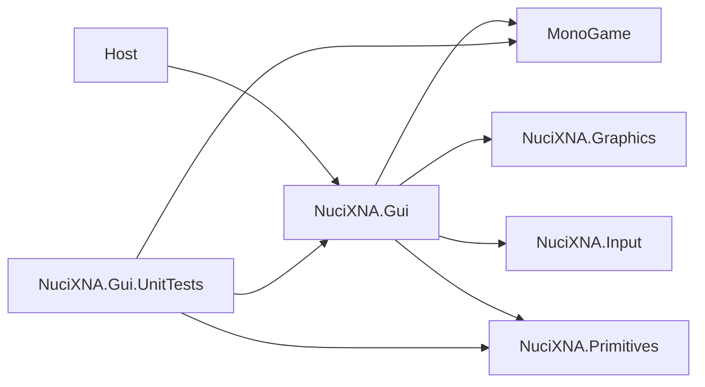

# Dependencies

## Runtime Packages

Source: [`NuciXNA.Gui/NuciXNA.Gui.csproj`](../NuciXNA.Gui/NuciXNA.Gui.csproj).

| Package | Version | Repository Usage | Public Contract Impact |
|---------|---------|------------------|------------------------|
| `MonoGame.Framework.DesktopGL` | `3.8.4` | `GameTime`, `SpriteBatch`, graphics/input enums and state | Consumers need compatible MonoGame types/runtime |
| `NuciXNA.Graphics` | `2.2.4` | `GraphicsManager`, `TextureSprite`, `TextSprite`, layouts, effects | Rendering/content/effect semantics and asset conventions |
| `NuciXNA.Input` | `2.1.1` | Global input events, mouse location/click query/handled flag, event args/delegates | Public control/screen events expose its delegate/args types |
| `NuciXNA.Primitives` | `2.1.7` | Geometry, colour, scale, mapping to XNA colour | Public layout/appearance API uses these types |

The library directly exposes dependency types, so package upgrades are not purely internal.

## Test Packages

Source: [`NuciXNA.Gui.UnitTests/NuciXNA.Gui.UnitTests.csproj`](../NuciXNA.Gui.UnitTests/NuciXNA.Gui.UnitTests.csproj).

| Package | Version | Purpose |
|---------|---------|---------|
| `Microsoft.NET.Test.Sdk` | `18.7.0` | Test host |
| `NUnit` | `4.6.1` | Test framework/assertions |
| `NUnit3TestAdapter` | `6.2.0` | NUnit discovery/execution adapter |
| `MonoGame.Framework.DesktopGL` | `3.8.4` | Types required by tests/library |
| `NuciXNA.Primitives` | `2.1.7` | Primitive values in tests |

The test project also references the library project directly and is not packable.

## Framework And Toolchain

- Both projects target `net10.0` only.
- The solution is [`NuciXNA.GUI.slnx`](../NuciXNA.GUI.slnx).
- CI installs .NET `10.0.x` on `ubuntu-latest`.
- CI installs Microsoft core fonts before build/tests because font-dependent graphics/test startup requires them in that environment.

## Internal Dependency Direction



Within the project:
- `ScreenManager` owns `IScreen` and graphics transition wrappers.
- `Screen` drives `GuiManager` and graphics-device clear.
- `GuiManager` owns root `GuiControl` references and queries `InputManager`.
- Concrete controls depend on graphics wrappers/effects and base input/primitive contracts.
- `GuiMenuLink`, `GuiTooltip`, and `MenuScreen` reach `ScreenManager`, so controls/screens are not strictly one-directional layers.

## Dependency Failure Semantics

No dependency exceptions are translated. Graphics/content/input/reflection failures propagate to the host. The library provides no retry, fallback renderer, input provider abstraction, or degraded mode.

## Current Restore Advisory

The 2026-10-13 Release restore/build reports `NU1902` and `NU1903` for `SixLabors.ImageSharp 3.1.12`. `dotnet nuget why NuciXNA.Gui/NuciXNA.Gui.csproj SixLabors.ImageSharp` verifies this transitive path:

```text
NuciXNA.Graphics 2.2.4
    -> NuciXNA.DataAccess 4.0.3
        -> SixLabors.ImageSharp 3.1.12
```

Reported advisories:
- [GHSA-gwg2-r3hj-4w44](https://github.com/advisories/GHSA-gwg2-r3hj-4w44)
- [GHSA-j3p4-wp97-rph4](https://github.com/advisories/GHSA-j3p4-wp97-rph4)
- [GHSA-j9gm-c75j-xc9q](https://github.com/advisories/GHSA-j9gm-c75j-xc9q)
- [GHSA-jjfr-hcj7-qf5w](https://github.com/advisories/GHSA-jjfr-hcj7-qf5w)
- [GHSA-wmxv-xphr-5c9g](https://github.com/advisories/GHSA-wmxv-xphr-5c9g)

Repository-specific exploitability has not been established. Resolve through a compatible upstream dependency update and rerun rendering/content tests; do not suppress the audit warning as a substitute for remediation.

## Upgrade Checklist

For any runtime package update:
1. Build and run all tests on .NET 10.
2. Inspect public type/signature changes, not only compilation.
3. Exercise graphics content loading, text/image rendering, effects, input events, and transition overlay manually or with new integration tests.
4. Recheck asset identifiers and font prerequisites.
5. Update project manifests, lock/assets output as generated by restore, dependency tables, architecture, and compatibility notes together.
6. Review security advisories and licence changes.

## Absent Dependencies

There is no HTTP client/server, database provider, serialiser, logger, telemetry SDK, dependency-injection container, scheduler, or persistence library in the project manifest.
