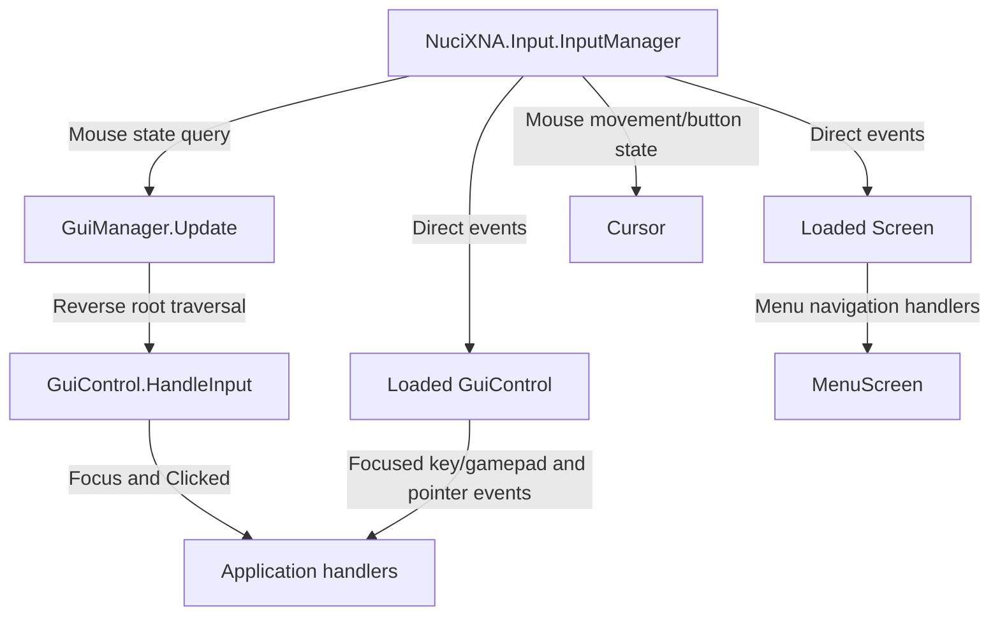
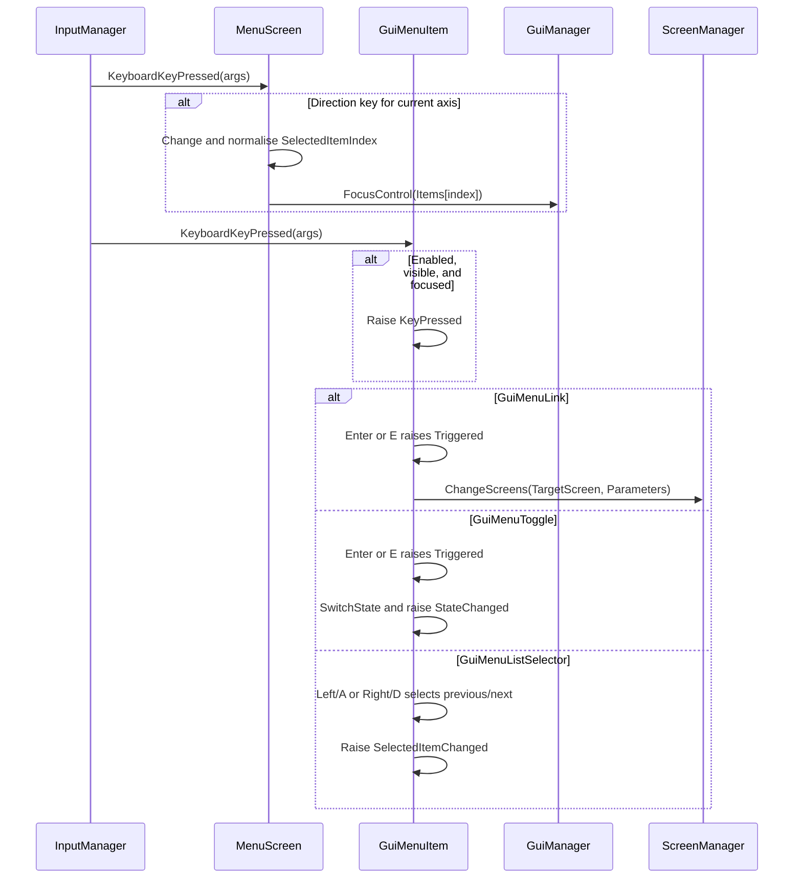
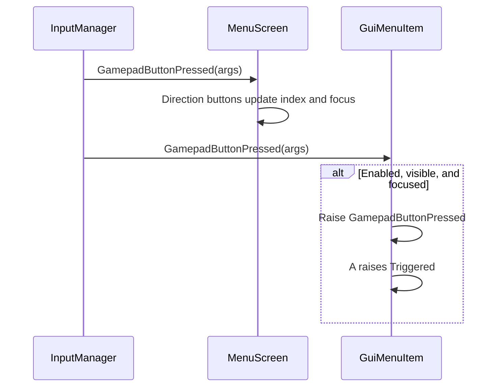
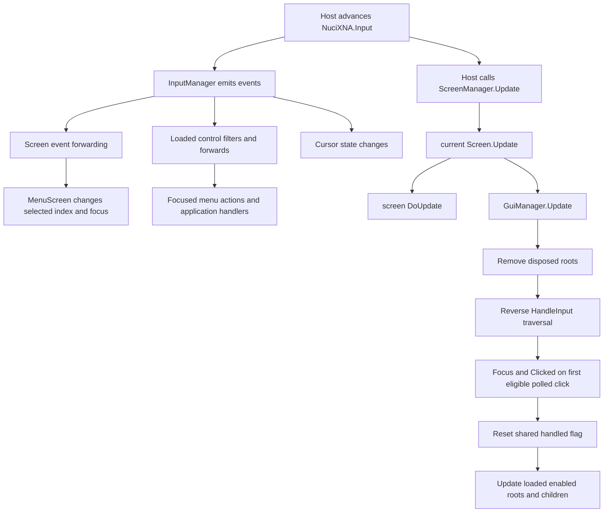

# Input Handling Flow

This document describes how NuciXNA.Gui consumes `NuciXNA.Input.InputManager`. Hardware polling and the input manager's own update lifecycle are outside this repository.

## Input Architecture



## InputManager (NuciXNA.Input)

### Used Contract

Production source uses these external members:
- `InputManager.Instance.KeyboardKeyHeldDown`, `KeyboardKeyPressed`, and `KeyboardKeyReleased`.
- `InputManager.Instance.GamepadButtonHeldDown`, `GamepadButtonPressed`, and `GamepadButtonReleased`.
- `InputManager.Instance.MouseButtonPressed`, `MouseButtonReleased`, and `MouseMoved`.
- `InputManager.Instance.MouseLocation`, `MouseButtonInputHandled`, and `IsLeftMouseButtonClicked()`.

### Update Cycle

The repository does not call an `InputManager.Update` method or specify its ordering. The consuming host must follow the NuciXNA.Input package contract before expecting current state or events.

### Events Fired

| External Event | Repository Subscribers |
|----------------|------------------------|
| `KeyboardKeyHeldDown` | Loaded `GuiControl` instances; forwarded only while focused, enabled, and visible |
| `KeyboardKeyPressed` | Loaded controls and loaded screens |
| `KeyboardKeyReleased` | Loaded controls |
| `GamepadButtonHeldDown` | Loaded controls |
| `GamepadButtonPressed` | Loaded controls and loaded screens |
| `GamepadButtonReleased` | Loaded controls |
| `MouseButtonPressed` | Loaded controls and loaded screens; cursor in paired-sprite mode |
| `MouseButtonReleased` | Cursor in paired-sprite mode |
| `MouseMoved` | Loaded controls, loaded screens, and loaded cursors |

### State Queries

`GuiControl.HandleInput` polls only `MouseLocation`, `MouseButtonInputHandled`, and `IsLeftMouseButtonClicked()`. Other state-query APIs are not evidenced by this repository.

## GuiManager Input Processing

### HandleInput Flow

```csharp
public void Update(GameTime gameTime)
{
    RemoveDisposedControls();

    List<GuiControl> controlValues = [.. guiControls.Values];

    for (int controlIndex = controlValues.Count - 1; controlIndex >= 0; controlIndex -= 1)
    {
        if (InputManager.Instance.MouseButtonInputHandled)
        {
            break;
        }

        if (controlValues[controlIndex].IsEnabled)
        {
            controlValues[controlIndex].HandleInput();
        }
    }

    InputManager.Instance.MouseButtonInputHandled = false;

    // Loaded, enabled roots update afterwards in forward snapshot order.
}
```

### Control.HandleInput

```csharp
public void HandleInput()
{
    if (IsEnabled &&
        IsVisible &&
        DisplayRectangle.Contains(InputManager.Instance.MouseLocation) &&
        !InputManager.Instance.MouseButtonInputHandled &&
        InputManager.Instance.IsLeftMouseButtonClicked())
    {
        MouseButtonEventArgs e = new(
            MouseButton.Left,
            ButtonState.Pressed,
            InputManager.Instance.MouseLocation);

        GuiManager.Instance.FocusControl(this);
        Clicked?.Invoke(this, e);
        InputManager.Instance.MouseButtonInputHandled = true;
    }

    foreach (GuiControl child in children)
    {
        if (InputManager.Instance.MouseButtonInputHandled)
        {
            break;
        }

        child.HandleInput();
    }
}
```

This polling path handles only a left-click query. Pointer movement and raw pressed-button events arrive through direct input-manager subscriptions described below.

---

## Hit Testing

### Display Rectangle

```csharp
public Point2D ScreenLocation
{
    get
    {
        if (Parent is not null)
        {
            return Location + Parent.ScreenLocation;
        }

        return Location;
    }
}

public Rectangle2D DisplayRectangle => new(ScreenLocation, Size);
```

### Coordinate Systems

```
Screen Coordinates (0,0 at top-left)
    │
    ├── GuiManager roots (dictionary values)
    │
    └── Control Hierarchy (Parent → Child)
        Parent.Location = (100, 100)
        Child.Location = (10, 10)  // Relative to parent
        Child.ScreenLocation = (110, 110)
        Child.DisplayRectangle = (110, 110, Child.Size)
```

### Hit Test Order

Roots are tested in reverse order of the manager snapshot. Within one root, `GuiControl.HandleInput` tests the parent before traversing children in child-list order.

```csharp
// In GuiManager.Update()
for (int index = controlValues.Count - 1; index >= 0; index -= 1)
{
    if (InputManager.Instance.MouseButtonInputHandled)
    {
        break;
    }

    controlValues[index].HandleInput();
}
```

The first eligible control sets the shared handled flag. The dictionary enumeration used to build the snapshot is an implementation detail, not a public z-order API. A parent that contains the pointer can consume the click before an overlapping child.

---

## Mouse Input Flow

```mermaid
sequenceDiagram
    participant IM as InputManager
    participant GM as GuiManager
    participant Ctrl as GuiControl
    participant App as Application

    IM->>Ctrl: MouseMoved(sender, args)
    Ctrl->>Ctrl: Ignore if disabled, hidden, unchanged, or entirely outside

    alt Mouse Entered Bounds
        Ctrl->>Ctrl: MouseMoved; IsHovered = true; MouseEntered
    else Mouse Left Bounds
        Ctrl->>Ctrl: MouseMoved; MouseLeft; IsHovered = false
    else Movement Inside Bounds
        Ctrl->>Ctrl: MouseMoved; IsHovered = true
    end

    IM->>Ctrl: MouseButtonPressed(sender, args)
    alt Enabled, visible, and location inside
        Ctrl->>Ctrl: MouseButtonPressed
        alt Left Button
            Ctrl->>Ctrl: Clicked; handled flag = true
        end
    end

    GM->>Ctrl: HandleInput() in reverse root order
    Ctrl->>IM: Query location, handled flag, left-click state
    Ctrl->>Ctrl: Focus through GuiManager; Clicked; handled flag = true

    Ctrl->>App: Event handlers execute
```

Controls do not expose a mouse-button-released event. `Cursor` alone subscribes to `InputManager.MouseButtonReleased` in paired-sprite mode.

### MouseButtonInputHandled

The flag belongs to `InputManager`, not to a control. `GuiManager.Update` stops root polling when it is true and resets it before control updates.

```csharp
for (int index = controlValues.Count - 1; index >= 0; index -= 1)
{
    if (InputManager.Instance.MouseButtonInputHandled)
    {
        break;
    }

    controlValues[index].HandleInput();
}

InputManager.Instance.MouseButtonInputHandled = false;
```

Direct `MouseButtonPressed` subscribers do not check the flag before raising events, so the flag is specifically an arbitration mechanism for manager polling and downstream input-manager behaviour, not a proof that only one overlapping control can ever observe the external event.

---

## Keyboard Input Flow

### Focus Model

Focused controls receive keyboard and gamepad events. `GuiManager.FocusControl` unfocuses every focused root and focuses the root whose `Id` matches; it does not traverse child collections.

```csharp
private void OnInputManagerKeyboardKeyPressed(object sender, KeyboardKeyEventArgs e)
{
    if (!IsEnabled || !IsVisible || !IsFocused)
    {
        return;
    }

    KeyPressed?.Invoke(sender, e);
}
```

`MenuScreen.SelectedItemIndex` is navigation state, not a control selection property. The screen calls `FocusControl(Items[index])` after directional input and when update normalises an out-of-range index.

### Navigation Keys (MenuScreen)

| Key / Button | Action |
|--------------|--------|
| `Up` / `W` / `DPadUp` / `LeftThumbstickUp` | Previous item (Vertical axis) |
| `Down` / `S` / `DPadDown` / `LeftThumbstickDown` | Next item (Vertical axis) |
| `Left` / `A` / `DPadLeft` / `LeftThumbstickLeft` | Previous item (Horizontal axis) / Decrement selector |
| `Right` / `D` / `DPadRight` / `LeftThumbstickRight` | Next item (Horizontal axis) / Increment selector |
| `Enter` / `E` | Trigger the focused `GuiMenuItem` |
| `A` (gamepad) | Trigger the focused `GuiMenuItem` |

### Keyboard Event Flow



---

## Gamepad Input Flow

### Gamepad Navigation

`MenuScreen` consumes `GamepadButtonPressed` events forwarded by its base screen. It maps D-pad and left-thumbstick direction buttons according to `Axis`.

```csharp
if (backButtons.Contains(e.Button))
{
    SelectedItemIndex -= 1;
}
else if (forwardButtons.Contains(e.Button))
{
    SelectedItemIndex += 1;
}

SelectedItemIndex = GetNormalisedItemNumber(SelectedItemIndex);
GuiManager.Instance.FocusControl(Items[SelectedItemIndex]);
```

### Gamepad Event Flow



---

## Control-Specific Input Behavior

### GuiMenuItem (Base)

- `Clicked` raises `Triggered`.
- Focused `Enter` or `E` raises `Triggered`.
- Focused gamepad `A` raises `Triggered`.
- Pointer entry focuses the item through `GuiManager`.

### GuiMenuLink

- `Triggered` calls `ScreenManager.Instance.ChangeScreens(TargetScreen, Parameters)`.

### GuiMenuToggle

- `Triggered` calls `SwitchState()`; state changes raise `StateChanged`.

### GuiMenuListSelector

- Focused keyboard `Right`/`D` and gamepad D-pad/thumbstick right call `SelectNextItem()`.
- Focused keyboard `Left`/`A` and gamepad D-pad/thumbstick left call `SelectPreviousItem()`.
- A pressed mouse button inside the selector advances for left and reverses for right.

### GuiTooltip

- Inherits all base pointer/focus events. It adds no control-specific input handler.

### GuiText / GuiImage

- Inherit base hit testing and events. They add no control-specific input handler.

---

## Input Event Arguments

### KeyboardKeyEventArgs

This repository reads `KeyboardKeyEventArgs.Key`.

### MouseButtonEventArgs

This repository reads `MouseButtonEventArgs.Button` and `MouseButtonEventArgs.Location`. The polling path constructs an instance from left button, pressed state, and current mouse location.

### GamepadButtonEventArgs

This repository reads `GamepadButtonEventArgs.Button`.

### ListSelectionEventArgs

```csharp
public class ListSelectionEventArgs : EventArgs
{
    public int SelectedIndex { get; set; }
    public string SelectedKey { get; set; }
    public string SelectedValue { get; set; }
}
```

---

## Application Event Handling

### Subscribing to Control Events

```csharp
var startLink = new GuiMenuLink
{
    Text = "Start Game",
    TargetScreen = typeof(GameScreen)
};

startLink.Triggered += (sender, e) =>
{
    // Optional host-owned side effect; the link also changes screens.
};

var fullscreenToggle = new GuiMenuToggle
{
    Text = "Fullscreen"
};
fullscreenToggle.SetState(graphics.IsFullScreen);

fullscreenToggle.StateChanged += (sender, e) =>
{
    graphics.IsFullScreen = fullscreenToggle.IsOn;
};

var difficultySelector = new GuiMenuListSelector
{
    Text = "Difficulty"
};
difficultySelector.SetItems("Easy", "Normal", "Hard");

difficultySelector.SelectedItemChanged += (sender, e) =>
{
    ListSelectionEventArgs selection = (ListSelectionEventArgs)e;
    settings.Difficulty = selection.SelectedValue;
};
```

### Event Handler Signature

```csharp
control.Clicked += OnClicked;                  // MouseButtonEventHandler
control.KeyPressed += OnKeyPressed;            // KeyboardKeyEventHandler
control.GamepadButtonPressed += OnButton;      // GamepadButtonEventHandler
control.MouseMoved += OnMouseMoved;            // MouseEventHandler
toggle.StateChanged += OnStateChanged;         // EventHandler
selector.SelectedItemChanged += OnSelection;  // EventHandler; args instance is ListSelectionEventArgs
```

---

## Input Processing Order



---

## Common Input Patterns

### Menu Activation

```csharp
menuItem.Triggered += (sender, e) =>
{
    // One handler for mouse click, Enter/E, or gamepad A activation.
};
```

Do not infer a universal once-per-frame guarantee from `MouseButtonInputHandled`; direct input-manager button events and manager polling are separate paths.

### Hold Detection

```csharp
control.KeyHeldDown += OnKeyHeldDown;
control.GamepadButtonHeldDown += OnGamepadButtonHeldDown;
```

These events reach a control only while it is enabled, visible, and focused.

### Hover State

```csharp
control.MouseEntered += OnMouseEntered;
control.MouseMoved += OnMouseMoved;
control.MouseLeft += OnMouseLeft;
```

`IsHovered` becomes true for relevant movement inside the rectangle and false on a movement from inside to outside. A stationary pointer does not recompute hover after the control moves.

### Unsupported Composite Gestures

The control contract has no mouse-release event, capture, drag, double-click, wheel, text-input, or gesture abstraction. Implementing these requires host or NuciXNA.Input subscriptions plus an explicit ownership policy.

---

## Input Debugging

### Event Tracing

```csharp
control.Focused += (sender, e) => hostLogger("focused");
control.Clicked += (sender, e) => hostLogger($"clicked at {e.Location}");
control.KeyPressed += (sender, e) => hostLogger($"key {e.Key}");
```

The repository provides no logger; any trace destination and redaction policy belong to the host.

### Bounds Inspection

Inspect `ScreenLocation`, `Size`, and `DisplayRectangle`. When diagnosing nested controls, inspect every ancestor's `Location`, effective `Size`, `IsEnabled`, and `IsVisible`. Any visual debug overlay must use host-provided drawing utilities; this library exposes no diagnostic renderer.

---

## Performance Considerations

The repository contains no input benchmark or measured event/hit-test cost. Structurally, each manager update can inspect every root in reverse until one consumes the click; each inspected root can recurse through children. Direct input events are delivered to every loaded subscriber and filtered inside each handler.

### Best Practices

1. Balance every `LoadContent()` with unload/disposal so controls unsubscribe from `InputManager`.
2. Register only root controls with `GuiManager`; compose descendants with protected child registration.
3. Use `IsSelectable = false` for menu labels that directional navigation should skip.
4. Use `FocusControl` for roots that should receive keyboard/gamepad input; note that it does not locate descendants.
5. Guard transition-sensitive handlers with `ScreenManager.Instance.Transitioning` because the old screen remains active during cover.
6. Add focused tests before changing reverse traversal, handled-flag reset timing, focus arbitration, or the dual direct/polled click paths; current tests do not cover them.