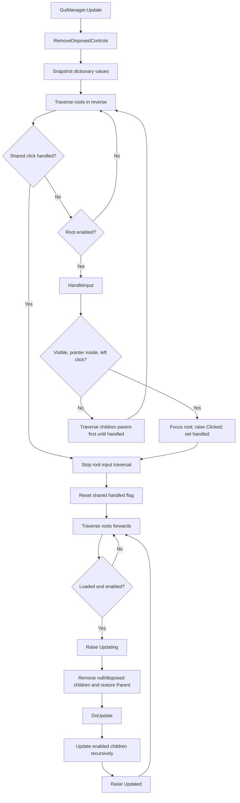
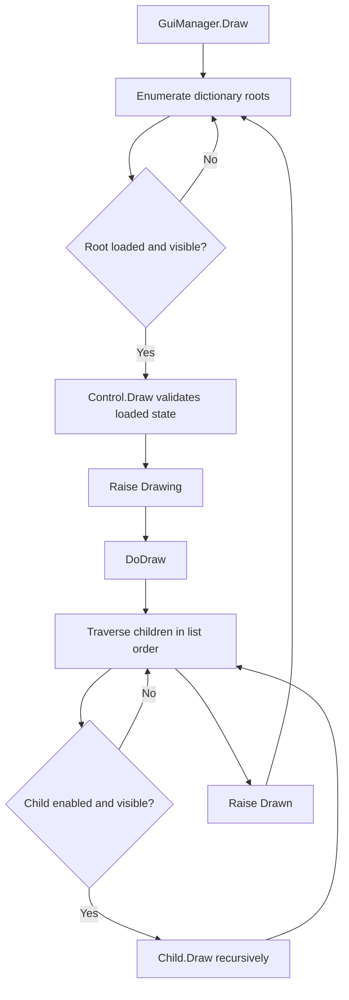
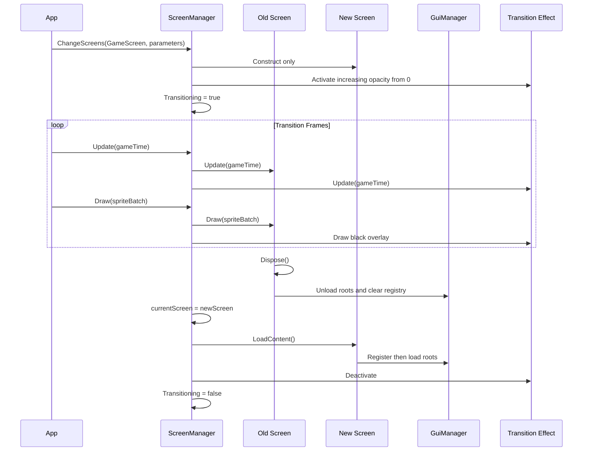
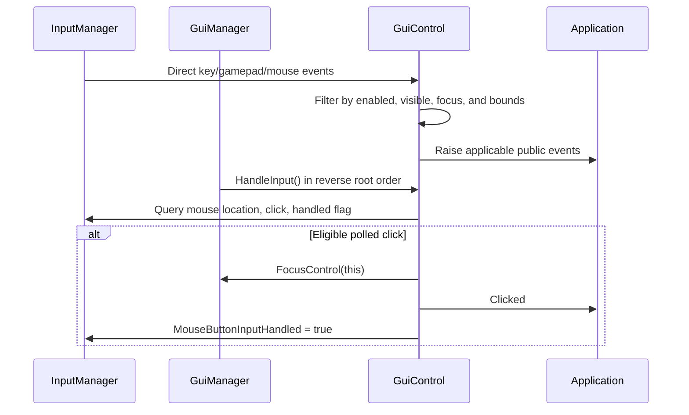
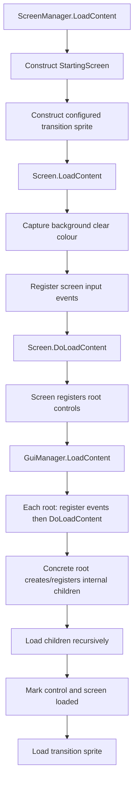
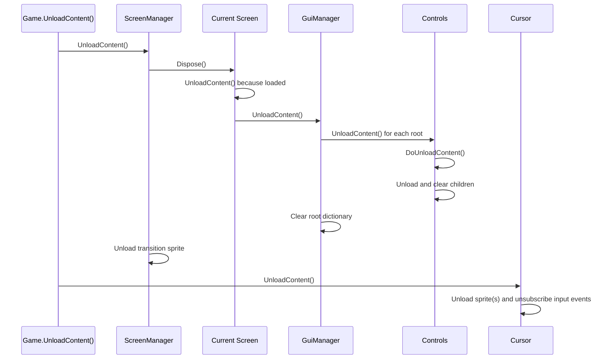

# Startup and Rendering Flow

This document describes the complete startup sequence and per-frame rendering flow for NuciXNA.Gui.

## Application Startup Sequence

```mermaid
sequenceDiagram
    participant App as Game Application
    participant C as Cursor
    participant SM as ScreenManager
    participant GM as GuiManager
    participant Scr as Starting Screen
    participant Ctrl as Controls

    App->>C: new Cursor()
    App->>C: LoadContent()
    C->>C: Load custom sprite or Cursors/idle + Cursors/click

    App->>SM: StartingScreenType = typeof(MainMenuScreen)
    App->>SM: LoadContent()
    SM->>Scr: Activator.CreateInstance(StartingScreenType)
    SM->>SM: Construct black transition sprite
    SM->>Scr: LoadContent()
    Scr->>Scr: Register input events; DoLoadContent()
    Scr->>GM: GuiManager.LoadContent()
    GM->>Ctrl: LoadContent() for each registered root
    Ctrl->>Ctrl: Register input events; DoLoadContent(); load children
    SM->>SM: transitionSprite.LoadContent()
```

Cursor loading is optional and independent. `ScreenManager.LoadContent` requires a constructible `StartingScreenType` that implements `IScreen`. No lifecycle call accepts a `ContentManager`, and there is no separate screen `Initialize` method.

## Per-Frame Update Flow

```mermaid
sequenceDiagram
    participant App as Game.Update()
    participant C as Cursor
    participant SM as ScreenManager
    participant GM as GuiManager
    participant Scr as Current Screen
    participant Ctrl as Controls

    App->>C: Update(gameTime)
    C->>C: Propagate location, size, and scale; update sprite(s)

    App->>SM: Update(gameTime)
    SM->>Scr: Update(gameTime)
    Scr->>Scr: Raise Updating; DoUpdate(gameTime)
    Scr->>GM: Update(gameTime)
    GM->>GM: Remove disposed roots; snapshot values
    GM->>Ctrl: HandleInput() in reverse until click handled
    GM->>GM: Reset shared handled flag
    GM->>Ctrl: Update loaded, enabled roots forwards
    Ctrl->>Ctrl: Clean children; DoUpdate(); update enabled children
    Scr->>Scr: Raise Updated
    opt Transitioning
        SM->>SM: Update overlay and swap at opacity >= 1
    end
```

The host is responsible for advancing NuciXNA.Input according to that package's contract. Input events can execute independently of `GuiManager.Update`; see [Input Handling](./input-handling.md).

## Per-Frame Draw Flow

```mermaid
sequenceDiagram
    participant App as Game.Draw()
    participant SB as SpriteBatch
    participant SM as ScreenManager
    participant Scr as Current Screen
    participant GM as GuiManager
    participant Ctrl as Controls
    participant C as Cursor
    participant Trans as Transition Sprite

    App->>SB: Begin()
    App->>SM: Draw(spriteBatch)
    SM->>Scr: Draw(spriteBatch)
    Scr->>GraphicsDevice: Clear(captured BackgroundColour)
    Scr->>Scr: Raise Drawing; DoDraw(spriteBatch)
    Scr->>GM: Draw(spriteBatch)
    GM->>Ctrl: Draw each loaded, visible root
    Ctrl->>Ctrl: DoDraw(); draw enabled, visible children
    Scr->>Scr: Raise Drawn
    opt Transitioning
        SM->>Trans: Draw black overlay after old screen
    end
    App->>C: Draw(spriteBatch) at host-selected position in draw order
    App->>SB: End()
```

The library does not call `SpriteBatch.Begin` or `End`. The host owns batching and decides whether an independently owned cursor draws before or after screens.

## Detailed Control Update Flow



## Detailed Control Draw Flow



A disabled root can still draw because the manager filters roots by loaded and visible state only. Descendant drawing additionally requires `IsEnabled`.

## Screen Transition Flow



For failure boundaries and request arbitration, see [Screen Transitions](./screen-transitions.md).

## Control Lifecycle Flow

```mermaid
stateDiagram-v2
    [*] --> Created: new Control()
    Created --> Owned: Register as manager root or control child
    Owned --> ContentLoading: LoadContent()
    ContentLoading --> ContentLoaded: DoLoadContent() complete
    ContentLoaded --> ContentLoaded: Update()/Draw() calls
    ContentLoaded --> ContentUnloading: UnloadContent() or Dispose()
    ContentUnloading --> ContentUnloaded: DoUnloadContent() complete
    ContentUnloaded --> Disposing: Dispose()
    Disposing --> Disposed: Dispose(true) complete
    Disposed --> [*]

    note right of ContentLoading: Register events; hook; load children
    note right of ContentUnloading: Clear Parent; unregister; hook; unload and clear children
    note right of Disposing: Snapshot children before unload clears them
```



Update, draw, and unload throw when content is not loaded; loading twice also throws. Disposal is idempotent. `Created` is raised inside the constructor, before ordinary external subscribers can attach.

## Input Event Flow



See [Input Handling](./input-handling.md) for the direct-event and polling paths.

## Content Loading Flow



## Shutdown Flow



`GuiManager.UnloadContent` unloads roots but does not explicitly dispose them. `ScreenManager.UnloadContent` does not null its screen fields.

## Timing Characteristics

The repository defines no frame rate, target duration, benchmark, or measured operation cost. All lifecycle calls are synchronous. Transition progress depends on supplied `GameTime` and the fixed fade speed.

## Performance Notes

- Manager work scales with root count; control work recursively scales with eligible descendants.
- Reverse input traversal can terminate early after a handled click.
- A transition retains normal old-screen work and adds one overlay update/draw; it does not update or draw two screens.
- Concrete image/text effects and host `SpriteBatch` configuration determine rendering cost.
- Performance claims require host-level profiling; no benchmark evidence exists here.